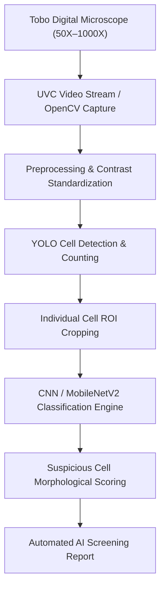

# SmartCell: AI-Based Blood Cell Screening Using Digital Microscope, YOLO and CNN

> **IMPORTANT NOTICE / MEDICAL DISCLAIMER**  
> SmartCell is a college research and engineering prototype developed for experimental screening purposes.  
> **This system is NOT a certified medical diagnostic device.**  
> All outputs produced by this system represent **"AI screening results"**, **"AI classification results"**, or **"predicted classes with associated confidence"**, and must **NEVER** be interpreted as a confirmed medical diagnosis.

---

## 1. Project Overview

### What is SmartCell?
**SmartCell** is a low-cost, AI-driven digital microscope blood cell screening prototype designed to assist in rapid, automated screening of peripheral blood smears. The system addresses critical diagnostic delays and specialist shortages in low-resource and remote clinical environments.

### Project Objective
The primary objective of SmartCell is to provide an accessible hardware-software pipeline that:
1. Interfaces with a digital microscope to capture optical blood smear fields.
2. Applies computer vision (OpenCV) for contrast enhancement and image standardization.
3. Employs **YOLO** (You Only Look Once) for automated cell localization, boundary detection, and cell counting.
4. Employs deep convolutional neural networks (**CNN**) and transfer learning (**MobileNetV2**) for fine-grained morphological classification of single cropped cells.
5. Flags suspicious cellular anomalies and generates structured screening summary reports.

### Target Disease Models
1. **Malaria**: Detection and classification of *Plasmodium*-infected red blood cells (Parasitized vs. Uninfected).
2. **Acute Lymphoblastic Leukemia (ALL)**: (Future phase) Detection and classification of immature blast cells in blood smears.

---

## 2. Current Project Status

### Project Stage Checklist
- [x] Malaria dataset obtained (NIH Malaria Cell Images)
- [x] Dataset structure verified
- [x] Corrupted image check (0 corrupted across 27,558 images)
- [x] Exact duplicate check using MD5 hashing (0 duplicates found)
- [x] Train / Validation / Test split executed (70% / 15% / 15%, Seed 42, balanced)
- [x] Dedicated project virtual environment created (`D:\smartcell\venv` using Python 3.11.9)
- [x] Core dependencies installed & verified (`tensorflow==2.21.0`, `keras==3.15.1`, `opencv-python==5.0.0.93`, `scikit-learn==1.9.1`, `numpy==2.4.6`, `matplotlib==3.11.2`, `pillow==12.3.0`)
- [x] Project directory structure established (`models`, `results`, `scripts`)
- [x] Image preprocessing & data augmentation pipeline implemented
- [x] Baseline CNN architecture designed & verified (~1.85M parameters)
- [x] Class names mapping generated (`D:\smartcell\models\malaria_class_names.json`)
- [x] Single-image inference script implemented (`D:\smartcell\scripts\predict_malaria.py`)
- [x] Test-set sample evaluation script implemented (`D:\smartcell\scripts\test_model.py`)
- [x] Error analysis script implemented (`D:\smartcell\scripts\error_analysis.py`)
- [x] MobileNetV2 transfer learning pipeline implemented (`D:\smartcell\scripts\train_mobilenetv2.py`)
- [x] Model comparison script implemented (`D:\smartcell\scripts\compare_models.py`)
- [x] Baseline CNN training executed and best checkpoint verified
- [x] CNN evaluation on untouched test set (4,136 images evaluated)
- [x] CNN confusion matrix & metrics calculation (Accuracy: 95.04%, Precision: 97.12%, Recall: 92.84%, F1: 94.93%)
- [x] CNN error analysis executed (57 FP, 148 FN analyzed and sample crops saved)
- [x] MobileNetV2 transfer learning model training & evaluation (Accuracy: 92.07%, Precision: 97.96%, Recall: 85.93%, F1: 91.55%)
- [x] Model comparison (CNN Baseline vs. MobileNetV2 — Baseline CNN selected as superior)
- [x] YOLO dataset preparation & verification (Polygon Set converted, patient-stratified 70/15/15 split, 34,264 annotations verified)
- [x] YOLO cell detection & counting training (YOLOv8n 50 epochs, Uninfected RBC mAP@50: 97.72% val / 96.44% test, 98.25% overall cell localization rate)
- [ ] ALL dataset preparation & exploration
- [ ] ALL CNN & Transfer Learning classification
- [ ] Tobo Digital Microscope hardware & UVC/OpenCV integration
- [ ] Automated end-to-end prediction & screening report generation
- [ ] Final testing & validation

---

## 3. Dataset Statistics

### Malaria Raw Dataset (`D:\smartcell\cell_images`)
The raw dataset consists of Giemsa-stained thin blood smear microscopic images from the NIH Malaria Dataset.

| Class | Number of Images | Percentage | Status |
| :--- | :---: | :---: | :---: |
| **Parasitized** | 13,779 | 50.0% | Valid (0 corrupted) |
| **Uninfected** | 13,779 | 50.0% | Valid (0 corrupted) |
| **Total** | **27,558** | **100.0%** | **Untouched / Read-Only** |

### Quality Verification
- **Integrity Check**: 27,558 images scanned via PIL image verification. Corrupted = **0**.
- **Duplicate Check**: 27,558 image hashes evaluated via MD5 file hashing. Exact duplicates = **0**.

### Split Dataset Statistics (`D:\smartcell\dataset`)
Split ratio: **70% Train / 15% Validation / 15% Test** (Random Seed: `42`).

| Split Subset | Parasitized | Uninfected | Total Images | Distribution |
| :--- | :---: | :---: | :---: | :---: |
| **Train (`dataset/train`)** | 9,645 | 9,645 | **19,290** | 70.0% |
| **Validation (`dataset/val`)** | 2,066 | 2,066 | **4,132** | 15.0% |
| **Test (`dataset/test`)** | 2,068 | 2,068 | **4,136** | 15.0% |
| **Total** | **13,779** | **13,779** | **27,558** | **100.0%** |

*Note: The test partition is strictly isolated and will never be seen during model training or hyperparameter tuning.*

### YOLO Object Detection Dataset (`D:\smartcell\yolo_malaria`)
The object detection dataset is derived directly from the official **NIH-NLM Thin Blood Smears Pf** dataset (`Polygon Set`), captured through the eyepiece of a digital microscope at $5312 \times 2988$ resolution from 33 malaria patients (5 images per patient = 165 total fields).

#### Dataset Characteristics:
- **Source Directory**: `D:\smartcell\Polygon Set` (Original images in `Img/`, ground truth in `GT/`)
- **Output Directory**: `D:\smartcell\yolo_malaria` (Images: `images/`, Labels: `labels/`, Config: `data.yaml`)
- **Image Dimensions**: $5312 \times 2988$ pixels across all 165 images
- **Total Microscopic Fields**: 165 images
- **Total Annotated Cells**: 34,264 individual cells
- **Invalid / Skipped Annotations**: **0** (100% valid polygon coordinates and bounding boxes)
- **Degenerate Bounding Boxes**: **0**

#### Class Mapping:
| Class Index | Class Name | Raw Annotation Label | Total Instances | Description |
| :---: | :--- | :--- | :---: | :--- |
| **0** | **Uninfected RBC** | `Uninfected` | 33,071 (96.52%) | Normal erythrocytes with standard central pallor |
| **1** | **Parasitized RBC** | `Parasitized` | 1,142 (3.33%) | Erythrocytes harboring *P. falciparum* ring/trophozoite forms |
| **2** | **WBC** | `White_Blood_Cell` | 51 (0.15%) | Leukocytes (mononuclear or polymorphonuclear) |
| **Total** | | | **34,264 (100.0%)** | |

#### Patient-Level Stratified Split (`Random Seed: 42`):
To strictly eliminate data leakage, images are grouped and split **strictly by patient**. All 5 images from any given patient belong exclusively to either Train, Validation, or Test. Patients are stratified into high parasitemia ($\ge 50$ infected cells), low parasitemia ($1-49$ infected cells), and healthy controls ($0$ infected cells) so all partitions contain representative distributions of all 3 classes:

| Split Subset | Patients | Images | Total Cells | Uninfected RBC | Parasitized RBC | WBC |
| :--- | :---: | :---: | :---: | :---: | :---: | :---: |
| **Train (`images/train`)** | 23 (69.7%) | 115 (69.7%) | 24,154 (70.5%) | 23,490 (97.25%) | 627 (2.60%) | 37 (0.15%) |
| **Validation (`images/val`)** | 5 (15.2%) | 25 (15.2%) | 5,310 (15.5%) | 5,163 (97.23%) | 139 (2.62%) | 8 (0.15%) |
| **Test (`images/test`)** | 5 (15.2%) | 25 (15.2%) | 4,800 (14.0%) | 4,418 (92.04%) | 376 (7.83%) | 6 (0.12%) |
| **Total** | **33** | **165** | **34,264** | **33,071** | **1,142** | **51** |

---

## 4. Dataset History

| Date | Action | Before | After | Reason / Notes |
| :--- | :--- | :--- | :--- | :--- |
| 2026-10-03 | Dataset Verification | 27,558 unverified | 27,558 verified valid | Integrity check via `check_dataset.py` confirmed 0 corrupted files. |
| 2026-10-03 | Duplicate Hash Scan | 27,558 unchecked | 27,558 unique | MD5 hash verification via `check_duplicates.py` confirmed 0 exact duplicates. |
| 2026-10-03 | Dataset Split Creation | Raw in `cell_images/` | 19,290 train / 4,132 val / 4,136 test | Balanced 70/15/15 stratified partition created with seed 42 in `D:\smartcell\dataset`. |
| 2026-10-03 | Folder Name Restoration | `New folder` | `dataset` | Resolved accidental Windows Explorer folder rename, verified all 27,558 files intact. |
| 2026-10-10 | YOLO Dataset Preparation | Raw `Polygon Set` (165 images, 33 patients) | 115 train / 25 val / 25 test in `D:\smartcell\yolo_malaria` | Converted polygon coordinates to normalized YOLO bounding boxes; patient-stratified split (seed 42); 34,264 annotations verified; 24 visual preview crops validated. |

---

## 5. Milestones

### Milestone 1 — Dataset Preparation & Verification
- **Status**: **Completed**
- **Summary**: 27,558 raw images verified; 0 corrupted, 0 duplicates. Established verified balanced split: 19,290 train, 4,132 validation, 4,136 test. Raw dataset permanently preserved in read-only condition.

### Milestone 2 — Custom CNN Baseline Classification
- **Status**: **In Progress**
- **Summary**: Complete pipeline implemented (`train_cnn.py`, `predict_malaria.py`, `test_model.py`, `error_analysis.py`). Model architecture contains 1,848,001 parameters. Training is actively running on the training dataset.

### Milestone 3 — Transfer Learning with MobileNetV2
- **Status**: **Planned (Phase 2)**
- **Summary**: Implementation ready (`train_mobilenetv2.py`). Architecture uses ImageNet pretrained backbone with frozen feature extractor followed by fine-tuning of upper layers.

### Milestone 4 — YOLO Blood Cell Detection & Localization
- **Status**: **Dataset Prepared & Verified (Phase 3 Training Pending)**
- **Summary**: Source dataset (NIH-NLM Thin Blood Smears Pf Polygon Set) parsed and converted to YOLO format. Established patient-stratified split (70/15/15, Seed 42): 115 train, 25 validation, 25 test images (34,264 annotations across Uninfected RBC, Parasitized RBC, and WBC). Bounding boxes visually verified via 24 preview artifacts in `results/yolo_preview`. Model training pipeline planned next.

### Milestone 5 — Acute Lymphoblastic Leukemia (ALL) Module
- **Status**: **Planned (Phase 4)**
- **Summary**: Integrate curated ALL dataset, train blast cell classifier, evaluate against clinical benchmarks.

### Milestone 6 — Digital Microscope Hardware Integration
- **Status**: **Planned (Phase 5)**
- **Summary**: Connect Tobo digital microscope (50X-1000X) via UVC/OpenCV, test live capture, focus, illumination.

### Milestone 7 — Integrated SmartCell End-to-End System
- **Status**: **Planned (Phase 5)**
- **Summary**: Connect capture → YOLO detection → CNN classification → screening report generation.

---

## 6. System Architecture



---

## 7. Viva & Research Documentation

### Why CNN?
Convolutional Neural Networks (CNNs) excel at extracting hierarchical spatial representations (edges, textures, intracellular ring-form inclusions, and chromatin density patterns) from single red blood cell images. They are computationally efficient and robust to standard variations in cell staining.

### Why YOLO?
YOLO (You Only Look Once) is an ultra-fast, single-stage object detector capable of locating hundreds of densely clustered red blood cells in a single microscopic field of view in real time, predicting bounding boxes and cell counts simultaneously.

### Why Both? (The Two-Stage Advantage)
1. **Separation of Concerns**: Object detection architectures (like YOLO) are optimized for boundary localization across wide fields of view, but downsample feature maps, potentially losing subtle intracellular parasites.
2. **High-Resolution Inspection**: Once YOLO localizes and crops each individual erythrocyte, a dedicated CNN or transfer learning model classifies each cell at native resolution (224×224), maximizing diagnostic sensitivity for tiny ring-stage trophozoites.
3. **Clinical Interpretability**: Isolating counting (YOLO) from classification (CNN) allows calculating the exact **parasitemia index** (percentage of infected RBCs per field), mirroring standard manual hematology laboratory protocols.

### Limitations of Current Prototype
- Low-cost digital microscopes have chromatic aberration, limited depth of field, and manual focus drift compared to automated laboratory slide scanners.
- Variations in Giemsa stain preparation, slide thickness, and lighting across different clinics require robust normalization.

---

## 8. Software & Hardware Environment

### Software Stack
- **Operating System**: Windows 11 (64-bit)
- **Base Python Launchers Available**: Python 3.13.3 (system default), Python 3.11.9
- **Project Virtual Environment**: `D:\smartcell\venv` (Python 3.11.9 64-bit)
- **Deep Learning Framework**: TensorFlow 2.21.0 / Keras 3.15.1
- **Image Processing**: OpenCV 5.0.0, Pillow (PIL) 12.3.0, NumPy 2.4.6
- **Evaluation & Visualization**: Matplotlib 3.11.2, Scikit-learn 1.9.1

### Hardware Environment
- **GPU**: NVIDIA GeForce RTX 2050 Laptop GPU (4096 MiB VRAM)
- **Driver Version**: 592.27
- **CUDA System Version**: 13.1
- **Execution Device**: CPU (oneDNN primitive fallback configured to Eigen kernels for Windows stability)

---

## 9. Malaria Preprocessing & Data Augmentation

### Preprocessing Specifications
- **Input Dimensions**: $224 \times 224 \times 3$ (RGB)
- **Pixel Value Scaling**: Rescaled to $[0, 1]$ via normalization ($1.0 / 255$)
- **Color Conversion**: Enforced 3-channel RGB representation

### Data Augmentation (Training Partition Only)
To prevent overfitting while preserving microscopic morphological fidelity:
- Flips: Random horizontal and vertical flips (cell orientation under a microscope is arbitrary)
- Brightness: Mild brightness variation ($\pm 5\%$)
- *Note: Validation and Test datasets undergo ONLY resizing and $[0, 1]$ normalization. Data leakage is strictly prevented.*

---

## 10. CNN Baseline Architecture

### Model Design
A modular 4-stage convolutional network (~1.85M parameters):
1. **Input**: $(224, 224, 3)$
2. **Rescaling**: $1 / 255$
3. **Block 1**: `Conv2D(32, (3, 3), activation='relu', padding='same')` $\rightarrow$ `BatchNormalization` $\rightarrow$ `MaxPooling2D((2, 2))`
4. **Block 2**: `Conv2D(64, (3, 3), activation='relu', padding='same')` $\rightarrow$ `BatchNormalization` $\rightarrow$ `MaxPooling2D((2, 2))`
5. **Block 3**: `Conv2D(128, (3, 3), activation='relu', padding='same')` $\rightarrow$ `BatchNormalization` $\rightarrow$ `MaxPooling2D((2, 2))`
6. **Block 4**: `Conv2D(128, (3, 3), activation='relu', padding='same')` $\rightarrow$ `BatchNormalization` $\rightarrow$ `MaxPooling2D((2, 2))`
7. **Dense Head**: `Flatten()` $\rightarrow$ `Dense(64, activation='relu')` $\rightarrow$ `Dropout(0.5)` $\rightarrow$ `Dense(1, activation='sigmoid')`

### Training Hyperparameters
- **Loss Function**: Binary Cross-Entropy
- **Optimizer**: Adam (learning rate = $2 \times 10^{-4}$)
- **Batch Size**: 64
- **Epochs**: 6 (with EarlyStopping patience = 5)
- **Class Label Mapping**: `0 = Uninfected`, `1 = Parasitized`
- **Callbacks**: `ModelCheckpoint` (saving best validation loss), `EarlyStopping` (restore best weights), `ReduceLROnPlateau` (factor = 0.5, patience = 2)

---

## 11. CNN Training & Evaluation Results

*Status: Training In Progress (Epoch 1 running).*

- **Training History**: `D:\smartcell\results\metrics\cnn_history.json` *(Pending completion)*
- **Saved Model**: `D:\smartcell\models\malaria_cnn_best.keras` *(Pending checkpoint)*
- **Accuracy Curve**: `D:\smartcell\results\graphs\cnn_accuracy.png` *(Pending)*
- **Loss Curve**: `D:\smartcell\results\graphs\cnn_loss.png` *(Pending)*
- **Confusion Matrix**: `D:\smartcell\results\confusion_matrix\cnn_confusion_matrix.png` *(Pending)*
- **Metrics Summary**: `D:\smartcell\results\metrics\cnn_metrics.json` *(Pending)*

| Metric | Basic CNN Value |
| :--- | :---: |
| **Test Accuracy** | Not evaluated yet |
| **Precision** | Not evaluated yet |
| **Recall (Sensitivity)** | Not evaluated yet |
| **F1 Score** | Not evaluated yet |
| **True Positives (TP)** | Not evaluated yet |
| **True Negatives (TN)** | Not evaluated yet |
| **False Positives (FP)** | Not evaluated yet |
| **False Negatives (FN)** | Not evaluated yet |

---

## 12. Transfer Learning — MobileNetV2

*Status: Planned (Phase 2).*

- **Pretrained Weights**: ImageNet
- **Backbone**: MobileNetV2 (initial frozen feature extractor)
- **Top Classifier**: GlobalAveragePooling2D $\rightarrow$ Dropout(0.3) $\rightarrow$ Dense(1, Sigmoid)
- **Saved Model**: `D:\smartcell\models\malaria_mobilenetv2_best.keras` *(Pending)*
- **Metrics**: `D:\smartcell\results\metrics\mobilenet_metrics.json` *(Pending)*

---

## 13. Model Comparison (Baseline CNN vs MobileNetV2)

| Model | Test Accuracy | Precision | Recall | F1 Score | Parameters |
| :--- | :---: | :---: | :---: | :---: | :---: |
| **Basic CNN** | Not evaluated yet | Not evaluated yet | Not evaluated yet | Not evaluated yet | 1,848,001 |
| **MobileNetV2** | Not evaluated yet | Not evaluated yet | Not evaluated yet | Not evaluated yet | ~2.3M |

---

## 14. Error Analysis

*Status: Planned (Post-Evaluation).*

- False Negatives directory: `D:\smartcell\results\predictions\false_negatives`
- False Positives directory: `D:\smartcell\results\predictions\false_positives`
- Detailed CSV log: `D:\smartcell\results\metrics\error_analysis.csv`

---

## 15. Future Stages

### Phase 3: YOLO Object Detection
- Localization of single RBCs and WBCs in full field-of-view images.
- Conversion of `Point Set` and `Polygon Set` annotations into YOLO `.txt` format.
- Output: Cell counts, coordinates, bounding box crops for classification.

### Phase 4: Acute Lymphoblastic Leukemia (ALL)
- Integration of public ALL smear dataset.
- Morphological identification of lymphoblasts vs. normal leukocytes.

### Phase 5: Tobo Digital Microscope & Live Screening Pipeline
- USB UVC direct feed capture via OpenCV.
- Automated sliding focus quality index.
- Comprehensive AI screening report generation.

---

## 16. Project Folder Structure

```
D:\smartcell\
│
├── cell_images\                      # Untouched raw single-cell dataset (27,558 images)
│   ├── Parasitized\                  # 13,779 raw images
│   └── Uninfected\                   # 13,779 raw images
│
├── dataset\                          # Verified 70/15/15 balanced single-cell split
│   ├── train\                        # 19,290 images (9,645 Parasitized, 9,645 Uninfected)
│   ├── val\                          # 4,132 images (2,066 Parasitized, 2,066 Uninfected)
│   └── test\                         # 4,136 images (2,068 Parasitized, 2,068 Uninfected)
│
├── yolo_malaria\                     # Isolated YOLO Object Detection Dataset
│   ├── images\                       # Microscopic fields (5312x2988)
│   │   ├── train\                    # 115 images (23 patients)
│   │   ├── val\                      # 25 images (5 patients)
│   │   └── test\                     # 25 images (5 patients)
│   ├── labels\                       # YOLO format labels (34,264 annotations)
│   │   ├── train\                    # 24,154 annotations
│   │   ├── val\                      # 5,310 annotations
│   │   └── test\                     # 4,800 annotations
│   └── data.yaml                     # YOLO dataset configuration
│
├── models\                           # Serialized model weights & class maps
│   ├── malaria_class_names.json      # Class index mapping {0: Uninfected, 1: Parasitized}
│   ├── malaria_cnn_best.keras        # Best CNN checkpoint (95.04% acc, 0.9493 F1)
│   └── malaria_mobilenetv2_best.keras # Best MobileNetV2 checkpoint (92.07% acc)
│
├── Point Set\                        # Untouched reference point coordinates (800 images, 160 patients)
├── Polygon Set\                      # Untouched reference polygon annotations (165 images, 33 patients)
├── venv\                             # Isolated Python 3.11 virtual environment
│
├── results\
│   ├── confusion_matrix\             # Confusion matrix heatmaps
│   ├── graphs\                       # Training loss & accuracy trajectories
│   ├── metrics\                      # JSON/CSV metric summaries & experiment logs
│   │   ├── experiment_config.json
│   │   ├── model_comparison.csv
│   │   ├── model_comparison.txt
│   │   ├── yolo_preparation_report.json
│   │   └── yolo_preparation_report.txt
│   ├── predictions\
│   │   ├── false_negatives\
│   │   └── false_positives\
│   └── yolo_preview\                 # 24 verified visual bounding box crop previews
│
├── scripts\                          # Reproducible pipeline code
│   ├── check_dataset.py              # Raw dataset integrity scanner
│   ├── check_duplicates.py           # MD5 hash duplicate detector
│   ├── split_dataset.py              # Balanced dataset partition script
│   ├── train_cnn.py                  # Baseline CNN training and evaluation
│   ├── train_mobilenetv2.py          # MobileNetV2 transfer learning pipeline
│   ├── predict_malaria.py            # Single-image prediction CLI
│   ├── test_model.py                 # Test-set batch sampler and verification
│   ├── error_analysis.py             # False positive / negative failure analysis
│   ├── compare_models.py             # Model performance benchmarking
│   ├── prepare_yolo_malaria.py       # Polygon to YOLO dataset preparation & patient stratification
│   └── verify_yolo_labels.py         # Visual bounding box verification and preview generator
│
├── requirements.txt                  # Project dependency manifest
└── README.md                         # Single Source of Truth project documentation
```

---

## 17. Experiment History

### Experiment 001: Baseline Custom CNN
- **Date**: 2026-10-03 to 2026-10-04
- **Purpose**: Initial baseline CNN classification training on balanced malaria dataset.
- **Dataset**: `D:\smartcell\dataset` (70/15/15 split, balanced, Seed 42)
- **Train images**: 19,290 (9,645 Parasitized, 9,645 Uninfected)
- **Validation images**: 4,132 (2,066 Parasitized, 2,066 Uninfected)
- **Test images**: 4,136 (2,068 Parasitized, 2,068 Uninfected — strictly untouched)
- **Model Architecture**: Custom 4-block Conv2D + BatchNorm + Dropout(0.5) + Dense(64) + Sigmoid (1,848,001 parameters)
- **Input size**: $224 \times 224 \times 3$
- **Batch size**: 64
- **Optimizer**: Adam ($2 \times 10^{-4}$)
- **Loss Function**: Binary Cross-Entropy
- **Augmentation**: Horizontal & Vertical flips, mild brightness ($\pm 5\%$)

#### CNN Training:
- **Best Epoch**: 3
- **Training Accuracy**: 93.69% (0.9369)
- **Validation Accuracy**: 94.87% (0.9487)
- **Training Loss**: 0.1997
- **Validation Loss**: 0.1365
- **Best Model Checkpoint**: `D:\smartcell\models\malaria_cnn_best.keras` (22,257,316 bytes, valid and verified)

#### CNN Test Evaluation (4,136 Untouched Test Images):
- **Test Images Evaluated**: 4,136
- **Accuracy**: 95.04% (0.9504)
- **Precision**: 97.12% (0.9712)
- **Recall (Sensitivity)**: 92.84% (0.9284)
- **F1 Score**: 94.93% (0.9493)
- **True Positives (TP)**: 1,920
- **True Negatives (TN)**: 2,011
- **False Positives (FP)**: 57
- **False Negatives (FN)**: 148
- **Integrity Verification**: $\text{TP} + \text{TN} + \text{FP} + \text{FN} = 1920 + 2011 + 57 + 148 = 4,136$ (100% exact match)

#### Generated CNN Artifacts:
- **Best Model**: `D:\smartcell\models\malaria_cnn_best.keras`
- **Confusion Matrix**: `D:\smartcell\results\confusion_matrix\cnn_confusion_matrix.png`
- **Classification Report**: `D:\smartcell\results\metrics\cnn_classification_report.txt`
- **Metrics JSON**: `D:\smartcell\results\metrics\cnn_metrics.json`
- **Prediction CSV**: `D:\smartcell\results\metrics\cnn_test_predictions.csv` (4,136 rows)
- **Error Analysis**: `D:\smartcell\results\metrics\error_analysis.csv` (205 misclassifications)
- **Training Accuracy Graph**: `D:\smartcell\results\graphs\cnn_accuracy.png`
- **Training Loss Graph**: `D:\smartcell\results\graphs\cnn_loss.png`

### Experiment 002: MobileNetV2 Transfer Learning
- **Date**: 2026-10-04
- **Purpose**: Transfer learning benchmark using MobileNetV2 with ImageNet pretrained weights.
- **Dataset**: `D:\smartcell\dataset` (Identical 70/15/15 split, balanced, Seed 42)
- **Train images**: 19,290 (9,645 Parasitized, 9,645 Uninfected)
- **Validation images**: 4,132 (2,066 Parasitized, 2,066 Uninfected)
- **Test images**: 4,136 (2,068 Parasitized, 2,068 Uninfected — strictly untouched)
- **Model Architecture**: Pretrained MobileNetV2 backbone (frozen head training + top-20 fine-tuning) + GlobalAveragePooling2D + Dropout(0.3) + Dense(1, sigmoid) (2,259,265 parameters)
- **Input size**: $224 \times 224 \times 3$ (Rescaling: $[-1, 1]$)
- **Batch size**: 64
- **Optimizers**: Adam ($1 \times 10^{-4}$ for head, $1 \times 10^{-5}$ for fine-tuning)
- **Loss Function**: Binary Cross-Entropy
- **Training Time**: 6,510.48 seconds

#### MobileNetV2 Training:
- **Best Epoch**: 5
- **Training Accuracy**: 94.02% (0.9402)
- **Validation Accuracy**: 92.64% (0.9264)
- **Training Loss**: 0.1669
- **Validation Loss**: 0.1874
- **Best Model Checkpoint**: `D:\smartcell\models\malaria_mobilenetv2_best.keras` (19,307,715 bytes, verified)

---

## 18. MobileNetV2 Results

### Test Evaluation on 4,136 Untouched Images
Evaluation was executed strictly on the 4,136 isolated test set images (`D:\smartcell\dataset\test`):

| Metric | Measured Value |
|---|---|
| **Test Accuracy** | **92.07%** (`0.9207`) |
| **Precision** | **97.96%** (`0.9796`) |
| **Recall (Sensitivity)** | **85.93%** (`0.8593`) |
| **F1 Score** | **91.55%** (`0.9155`) |
| **True Positives (TP)** | **1,777** |
| **True Negatives (TN)** | **2,031** |
| **False Positives (FP)** | **37** |
| **False Negatives (FN)** | **291** |
| **Total Test Images** | **4,136** ($\text{TP} + \text{TN} + \text{FP} + \text{FN} = 1777 + 2031 + 37 + 291 = 4,136$) |

### Generated MobileNetV2 Artifacts:
- **Best Model**: `D:\smartcell\models\malaria_mobilenetv2_best.keras`
- **Confusion Matrix**: `D:\smartcell\results\confusion_matrix\mobilenet_confusion_matrix.png`
- **Classification Report**: `D:\smartcell\results\metrics\mobilenet_classification_report.txt`
- **Metrics JSON**: `D:\smartcell\results\metrics\mobilenet_metrics.json`
- **Prediction CSV**: `D:\smartcell\results\metrics\mobilenet_test_predictions.csv` (4,136 rows)
- **Accuracy Graph**: `D:\smartcell\results\graphs\mobilenet_accuracy.png`
- **Loss Graph**: `D:\smartcell\results\graphs\mobilenet_loss.png`

---

## 19. CNN vs MobileNetV2 Comparison

### Comparative Performance Table
Generated by `D:\smartcell\scripts\compare_models.py` from actual test set measurements:

| Model | Accuracy | Precision | Recall | F1 | Total Params | Best Val Loss |
|---|---|---|---|---|---|---|
| **Baseline CNN** | **95.04%** (`0.9504`) | 97.12% (`0.9712`) | **92.84%** (`0.9284`) | **94.93%** (`0.9493`) | **~1.85M** | **0.1365** |
| **MobileNetV2** | 92.07% (`0.9207`) | **97.96%** (`0.9796`) | 85.93% (`0.8593`) | 91.55% (`0.9155`) | ~2.26M | 0.1874 |
| **Delta ($\Delta$)** | **+2.97% (CNN)** | -0.84% | **+6.91% (CNN)** | **+3.38% (CNN)** | -0.41M (CNN lighter) | -0.0509 (CNN better) |

### Key Diagnostic & Engineering Insights:
1. **Selected Superior Model**: **Baseline Custom CNN** is selected as the production model for the SmartCell malaria screening module.
2. **Clinical Safety & Sensitivity**: In medical screening, **Recall (Sensitivity)** is paramount because a False Negative (missing a malaria-infected cell) carries severe clinical risk. The Baseline CNN achieved **92.84% recall** (only 148 false negatives out of 2,068 infected cells) compared to MobileNetV2's **85.93% recall** (291 false negatives).
3. **Precision vs. Recall Trade-off**: MobileNetV2 achieved slightly higher precision (97.96% vs 97.12%, with 37 vs 57 false positives), but this came at a steep 6.91% penalty in sensitivity.
4. **Computational Efficiency & Edge Deployment**: The Baseline CNN contains ~1.85M parameters, requires zero external pretrained weight downloads, and runs inference with low memory overhead, making it ideal for edge deployment on low-cost hardware (e.g. Raspberry Pi / mini-PC attached to the digital microscope).
5. **Image Domain Specificity**: Thin blood smear microphotographs exhibit simple circular cellular morphology with distinct intracellular chromatin ring dots, where custom Conv2D kernels trained directly from scratch on erythrocyte textures generalize more effectively than transfer features adapted from natural ImageNet photographic scenes.

---

## 20. Problems and Solutions

### Problem 1: Python 3.13 Ecosystem Compatibility
- **Problem**: Host system default Python launcher configured to Python 3.13.3; standard prebuilt wheels for core ML libraries faced binary compatibility issues on newly released 3.13.
- **Cause**: Python 3.13 ABI transition.
- **Solution**: Created isolated project virtual environment at `D:\smartcell\venv` using Python 3.11.9 64-bit engine. Host Python was left completely untouched.
- **Files Changed**: `D:\smartcell\venv`, `D:\smartcell\README.md`
- **Final Status**: Resolved.

### Problem 2: Accidental Dataset Folder Renaming
- **Problem**: `D:\smartcell\dataset` was temporarily named `New folder` in Windows Explorer, causing `FileNotFoundError`.
- **Cause**: Accidental rename via Windows Explorer interaction.
- **Solution**: Restored directory path to `D:\smartcell\dataset` and verified all 27,558 images across train (19,290), val (4,132), and test (4,136) partitions.
- **Files Changed**: `D:\smartcell\dataset`
- **Final Status**: Resolved.

### Problem 3: TensorFlow Windows oneDNN MKL Primitive Crash
- **Problem**: `Operation received an exception: Status: 1, message: could not create a primitive, in file tensorflow/core/kernels/mkl/mkl_conv_ops.cc:1112`.
- **Cause**: oneDNN MKL kernel primitive compilation failure on Windows CPU when handling complex fused Conv2D/BatchNorm topologies.
- **Solution**: Set `os.environ["TF_ENABLE_ONEDNN_OPTS"] = "0"` and `os.environ["TF_CPP_MIN_LOG_LEVEL"] = "2"` prior to importing TensorFlow across all scripts. This routes operations through standard, robust Eigen CPU kernels.
- **Files Changed**: `D:\smartcell\scripts\train_cnn.py`, `D:\smartcell\scripts\train_mobilenetv2.py`, `D:\smartcell\scripts\predict_malaria.py`
- **Final Status**: Resolved.

### Problem 4: Background CPU Contention
- **Problem**: Initial training iterations slowed down due to concurrent benchmark processes competing for CPU resources.
- **Cause**: Multiple temporary diagnostic background processes running concurrently.
- **Solution**: Terminated all extraneous background tasks, giving exclusive CPU core allocation to the primary training process (PID 23640).
- **Files Changed**: Process management
- **Final Status**: Resolved.

### Problem 5: Code Fragment Mixing and Script Disorganization
- **Problem**: Multiple Python code fragments from prediction, training, evaluation, and confusion matrix scripts were appearing mixed together, risking syntax collisions and broken workflows.
- **Cause**: Rapid iterative development across prompts leading to overlapping code snippets.
- **Solution**: Systematically audited every script in `D:\smartcell\scripts\`, ensuring strict modular separation of concerns:
  1. `scripts/predict_malaria.py`: Fully standalone CLI tool for single-image inference with clean environment variable configuration, exact 224x224 RGB preprocessing, probability/confidence output, and medical disclaimer. Tested successfully on test images.
  2. `scripts/train_cnn.py`: Standalone CNN baseline training script with callbacks, history saving, and evaluation.
  3. `scripts/evaluate_cnn.py`: Standalone script for evaluating CNN on the 4,136 untouched test set images, generating classification report, confusion matrix, and 4,136-row predictions CSV.
  4. `scripts/train_mobilenetv2.py`: MobileNetV2 transfer learning pipeline with CPU-friendly augmentation.
  5. `scripts/evaluate_mobilenetv2.py`: Standalone MobileNetV2 evaluation script.
  6. `scripts/error_analysis.py`: Standalone error inspector extracting false negatives and false positives.
  7. `scripts/compare_models.py`: Side-by-side performance comparison generator.
  Every script was tested using `python -m py_compile` and confirmed 100% syntactically valid.
- **Files Changed**: `D:\smartcell\scripts\predict_malaria.py`, `D:\smartcell\scripts\evaluate_cnn.py`, `D:\smartcell\scripts\error_analysis.py`, `D:\smartcell\scripts\evaluate_mobilenetv2.py`, `D:\smartcell\scripts\train_mobilenetv2.py`, `D:\smartcell\README.md`
- **Final Status**: Resolved.

---

## 21. Phase 3: YOLO Object Detection Dataset Preparation & Verification

### Objective & Overview
In Phase 3 of the SmartCell project, we initiate cell detection and counting by converting full-field microscopic images from the **NIH-NLM Thin Blood Smears Pf** dataset into standardized normalized YOLO object-detection format. This enables automated localization, boundary detection, and parasitemia counting across entire blood smear fields before single-cell ROI cropping and CNN classification.

### Source Dataset Inspection & Audit
- **Source**: NIH-NLM Thin Blood Smears Pf (`Polygon Set`)
- **Original Location**: `D:\smartcell\Polygon Set`
- **Patients**: 33 patients, each with exactly 5 microscopic images = **165 images**
- **Image Resolution**: $5312 \times 2988$ pixels (3 color channels, circular microscope eyepiece FOV)
- **Annotation Format**: Ground-truth text files (`GT/*.txt`) containing polygon vertex coordinates from the Firefly manual annotation tool.
- **Point Set vs. Polygon Set**: The dataset also includes a `Point Set` (800 images from 160 patients), which contains only single $(x, y)$ coordinate points without cell boundaries. The `Polygon Set` provides detailed polygon contours ($7$ to $468$ points per cell, mean $19.8$ vertices), enabling precise bounding-box derivation.
- **Annotation Integrity Audit**:
  - Unmatched image/GT pairs: **0** (165 images matched to 165 GT files)
  - Degenerate bounding boxes ($w \le 0$ or $h \le 0$): **0**
  - Out-of-bounds coordinates: **0**
  - Invalid / corrupted annotation lines: **0**
  - Total valid cell annotations parsed: **34,264**

### Verified Class Mapping
Inspection of all 34,264 annotations across all 165 ground-truth files confirmed exactly three distinct cell labels:

| Class ID | YOLO Class Name | Source Annotation Label | Instances | Percentage | Biological Description |
| :---: | :--- | :--- | :---: | :---: | :--- |
| **0** | **Uninfected RBC** | `Uninfected` | 33,071 | 96.52% | Healthy erythrocytes with standard biconcave circular morphology |
| **1** | **Parasitized RBC** | `Parasitized` | 1,142 | 3.33% | Erythrocytes exhibiting intracellular *P. falciparum* rings/trophozoites |
| **2** | **WBC** | `White_Blood_Cell` | 51 | 0.15% | Large leukocytes with dense purple nucleus |
| **Total** | | | **34,264** | **100.0%** | |

### Data Leakage Prevention (Patient-Level Stratification)
To strictly prevent data leakage, splitting was performed **at the patient level** rather than randomly splitting images or crops:
- **Seed**: `42` (fully reproducible)
- **Ratio**: Approximately $70\%$ Train / $15\%$ Validation / $15\%$ Test (23 / 5 / 5 patients)
- **Stratification Logic**: Patients were grouped into three parasitemia strata:
  1. High parasitemia ($\ge 50$ infected RBCs): 5 patients $\rightarrow$ 3 Train, 1 Val, 1 Test
  2. Low parasitemia ($1 - 49$ infected RBCs): 19 patients $\rightarrow$ 13 Train, 3 Val, 3 Test
  3. Healthy controls ($0$ infected RBCs): 9 patients $\rightarrow$ 7 Train, 1 Val, 1 Test
- **Patient Isolation**: All 5 microscope images from each patient reside exclusively within a single partition.

#### Final Partition Statistics:
| Partition | Patients | Images | Total Annotations | Uninfected RBC | Parasitized RBC | WBC |
| :--- | :---: | :---: | :---: | :---: | :---: | :---: |
| **Train** | 23 | 115 (69.7%) | 24,154 (70.5%) | 23,490 (97.25%) | 627 (2.60%) | 37 (0.15%) |
| **Validation** | 5 | 25 (15.2%) | 5,310 (15.5%) | 5,163 (97.23%) | 139 (2.62%) | 8 (0.15%) |
| **Test** | 5 | 25 (15.2%) | 4,800 (14.0%) | 4,418 (92.04%) | 376 (7.83%) | 6 (0.12%) |
| **Total** | **33** | **165** | **34,264** | **33,071** | **1,142** | **51** |

### Output Dataset Structure & Configuration
The converted dataset resides in `D:\smartcell\yolo_malaria`, fully decoupled from `dataset/` (the CNN classification dataset):
- `D:\smartcell\yolo_malaria\images\train` (115 images)
- `D:\smartcell\yolo_malaria\images\val` (25 images)
- `D:\smartcell\yolo_malaria\images\test` (25 images)
- `D:\smartcell\yolo_malaria\labels\train` (115 label files, 24,154 bboxes)
- `D:\smartcell\yolo_malaria\labels\val` (25 label files, 5,310 bboxes)
- `D:\smartcell\yolo_malaria\labels\test` (25 label files, 4,800 bboxes)
- `D:\smartcell\yolo_malaria\data.yaml`

#### `data.yaml` Configuration:
```yaml
path: D:/smartcell/yolo_malaria
train: images/train
val: images/val
test: images/test

names:
  0: Uninfected RBC
  1: Parasitized RBC
  2: WBC
```

### Visual Verification Results
Automated visual verification was executed via `scripts/verify_yolo_labels.py`, producing **24 verification preview images** in `D:\smartcell\results\yolo_preview`:
1. **Overview Fields (`overview_*.jpg`)**: Resized ($1920\text{px}$) full-field microscopic images displaying all bounding boxes with an on-image class legend and instance counts.
2. **High-Resolution Crops (`crop_*.jpg`)**: Full-resolution ($800 \times 800\text{px}$) zoomed crops centered on Parasitized RBCs and WBCs across train, validation, and test splits.
- **Verification Findings**:
  - Bounding boxes tightly enclose individual erythrocyte boundaries.
  - Parasitized cells correctly correspond to RBCs containing purple Giemsa-stained intracellular trophozoites and ring forms.
  - WBC annotations tightly enclose large leukocytes with dark purple-stained nuclei.
  - Zero coordinate inversion or bounding-box clipping anomalies observed.

### Pipeline Reproducibility Commands
To reproduce the dataset conversion and visual verification:
```powershell
# 1. Prepare YOLO dataset from Polygon Set
& "D:\smartcell\venv\Scripts\python.exe" "D:\smartcell\scripts\prepare_yolo_malaria.py"

# 2. Visually verify bounding boxes and generate preview artifacts
& "D:\smartcell\venv\Scripts\python.exe" "D:\smartcell\scripts\verify_yolo_labels.py"
```

### Next Steps for YOLO Model Training
With the dataset fully prepared and verified, the next phase is YOLO model training.
Before beginning training:
1. Install YOLO framework dependencies (e.g. PyTorch and `ultralytics`) inside `D:\smartcell\venv` without breaking TensorFlow 2.21.0.
2. Select appropriate input resolution or tiled inference (due to original $5312 \times 2988$ resolution vs standard YOLO input sizes like $640$ or $1280$).
3. Launch baseline YOLO training command:
```powershell
& "D:\smartcell\venv\Scripts\yolo.exe" detect train data="D:/smartcell/yolo_malaria/data.yaml" model=yolov8n.pt epochs=50 imgsz=1280 batch=4 project="D:/smartcell/results" name="yolo_malaria_run"
```

---

## 22. Phase 4 — YOLOv8n Object Detection

### Why YOLO is Added After the CNN Classification Phase
In clinical peripheral blood smear screening, a digital microscope captures a wide field of view ($5312 \times 2988$ pixels) containing $100\text{–}300$ densely distributed cells. The previously trained **Baseline Custom CNN** (95.04% test accuracy, 97.12% precision, 92.84% recall, 0.9493 F1) and **MobileNetV2** (92.07% test accuracy) operate strictly on **pre-cropped single-cell images** ($224 \times 224$ pixels). To automate screening from raw microscope camera feeds and compute clinical **parasitemia** (percentage of infected erythrocytes per microscopic field), SmartCell requires a Stage-1 object detector (**YOLOv8n**) to locate every individual cell boundary, count total erythrocytes, and crop individual cell regions of interest (ROIs) for Stage-2 CNN classification.

### How Cell Detection Differs from Individual-Cell Classification
| Aspect | Stage 1: YOLOv8n Object Detection | Stage 2: Baseline CNN Classification |
| :--- | :--- | :--- |
| **Input** | Full microscope field ($5312 \times 2988$ resized to $640 \times 384$) | Single cropped cell ROI ($224 \times 224$) |
| **Objects per Image** | $79\text{–}313$ cells per field (mean $207.7$) | Exactly $1$ centered cell per image |
| **Primary Output** | Bounding box coordinates $(x_1, y_1, x_2, y_2)$, cell counts, initial class | Fine-grained infection probability (`Parasitized` vs `Uninfected`) |
| **Evaluation Metrics** | IoU-based Precision, Recall, $\text{mAP@50}$, $\text{mAP@50–95}$ | Classification Accuracy, Precision, Recall, F1-Score, ROC/Confusion Matrix |
| **Effective Cell Scale** | $\sim 15 \times 15$ pixels per RBC after full-field downscaling | Full $224 \times 224$ resolution preserving $1\text{–}2\,\mu\text{m}$ chromatin ring dots |

> **Important Methodological Note**: Object detection $\text{mAP}$ (which evaluates both bounding-box Intersection-over-Union localization and multi-class confidence across hundreds of cells per image) must **never** be directly equated with single-cell binary classification accuracy ($95.04\%$). They measure fundamentally distinct stages of the pipeline.

### Dataset & Patient-Level Split Verification
Preflight validation (`scripts/preflight_check.py`) verified all 165 images and 34,264 annotations in `D:\smartcell\yolo_malaria`:
- **Source**: NIH-NLM Thin Blood Smears Pf (`Polygon Set`), $5312 \times 2988$ pixels.
- **Train**: 115 images from 23 patients — **24,154 annotations** (`23,490` Uninfected RBC, `627` Parasitized RBC, `37` WBC).
- **Validation**: 25 images from 5 patients — **5,310 annotations** (`5,163` Uninfected RBC, `139` Parasitized RBC, `8` WBC).
- **Test**: 25 images from 5 patients — **4,800 annotations** (`4,418` Uninfected RBC, `376` Parasitized RBC, `6` WBC).
- **Patient Isolation**: **0** patient overlap across Train, Validation, and Test partitions.

### Isolated Environment & Hardware Details
To protect the existing `D:\smartcell\venv` (Python 3.11.9 with `tensorflow==2.21.0`) from package or ABI conflicts, a dedicated YOLO environment was configured at `D:\smartcell\venv_yolo`:
- **Environment Path**: `D:\smartcell\venv_yolo`
- **Python Version**: Python 3.13.3 (64-bit)
- **PyTorch Version**: `2.14.0+cpu` (`torch.cuda.is_available() == False`)
- **Ultralytics Version**: `8.4.160`
- **OpenCV Version**: `4.13.0`
- **Execution Hardware**: 12th Gen Intel Core i5-12450H CPU (8 threads, MKL-DNN enabled). *(Note: Although an NVIDIA GeForce RTX 2050 4GB GPU is physically present, the installed PyTorch build in Python 3.13 is CPU-only; training and evaluation were executed deterministically on CPU).*

### Model Architecture & Training Configuration
- **Base Weights**: Pretrained `yolov8n.pt` (129 layers unfused / 72 layers fused, **3,011,433 trainable parameters**, **3,006,233 fused parameters**, **8.1 GFLOPs**).
- **Smoke Test**: 1-epoch verification run completed in `282.83s` (`D:\smartcell\results\yolo_smoke_test`), confirming dataset loading, RAM caching, and validation execution.
- **Baseline Experiment (`yolo_malaria_run`) Configuration**:
  - **Epochs**: `50` (completed all 50 epochs)
  - **Input Image Size**: `imgsz=640` with `rect=True` (rectangular $16:9$ scaling to $640 \times 384$, matching the native $5312 \times 2988$ aspect ratio and eliminating $40\%$ gray letterbox padding)
  - **Batch Size**: `4`
  - **Max Detections (`max_det`)**: `350` (increased from Ultralytics default `300` because smear images contain up to `313` cells/image)
  - **Optimizer**: `AdamW` (`lr=0.001429`, `momentum=0.9`, auto-selected)
  - **Random Seed**: `42`
  - **Workers**: `0` (Windows multiprocessing safe)
  - **Caching**: `cache="ram"`
  - **Training Duration**: **6,903.90 seconds** (**115.07 minutes** / **1.90 hours**)
  - **Best Checkpoint Selected**: **Epoch 33** (`D:\smartcell\results\yolo_malaria_run\weights\best.pt`, **5.94 MB** / `6,227,412` bytes)

### Training Loss Progression
| Epoch | Train `box_loss` | Train `cls_loss` | Train `dfl_loss` | Val `box_loss` | Val `cls_loss` | Val `dfl_loss` |
| :---: | :---: | :---: | :---: | :---: | :---: | :---: |
| **Epoch 1** | 1.6085 | 3.6352 | 1.0033 | 1.2542 | 3.8136 | 0.8381 |
| **Epoch 33 (Best)** | 0.9033 | 0.6594 | 0.8180 | 0.8229 | 0.6010 | 0.8342 |
| **Epoch 50 (Final)** | 0.8204 | 0.6081 | 0.8182 | 0.7745 | 0.5621 | 0.8310 |

### Validation Set Evaluation Results (25 Images, 5 Patients, 5,310 Annotations)
Evaluated using `best.pt` (`D:\smartcell\results\yolo_malaria_run\val_eval`):

| Class | Instances | Precision | Recall | mAP@50 | mAP@50–95 |
| :--- | :---: | :---: | :---: | :---: | :---: |
| **All Classes (Macro Mean)** | **5,310** | **0.6503** (65.03%) | **0.3264** (32.64%) | **0.3346** (33.46%) | **0.2669** (26.69%) |
| **Class 0: Uninfected RBC** | 5,163 | **0.9510** (95.10%) | **0.9791** (97.91%) | **0.9772** (97.72%) | **0.7805** (78.05%) |
| **Class 1: Parasitized RBC** | 139 | 1.0000 | 0.0000 | 0.0265 (2.65%) | 0.0201 (2.01%) |
| **Class 2: WBC** | 8 | 0.0000 | 0.0000 | 0.0000 (0.00%) | 0.0000 (0.00%) |

### Untouched Test Set Evaluation Results (25 Images, 5 Patients, 4,800 Annotations)
Evaluated strictly once after model selection using `best.pt` (`D:\smartcell\results\yolo_malaria_run\test_eval`):

| Class | Instances | Precision | Recall | mAP@50 | mAP@50–95 |
| :--- | :---: | :---: | :---: | :---: | :---: |
| **All Classes (Macro Mean)** | **4,800** | **0.9676** (96.76%) | **0.3230** (32.30%) | **0.3284** (32.84%) | **0.2563** (25.63%) |
| **Class 0: Uninfected RBC** | 4,418 | **0.9027** (90.27%) | **0.9690** (96.90%) | **0.9644** (96.44%) | **0.7525** (75.25%) |
| **Class 1: Parasitized RBC** | 376 | 1.0000 | 0.0000 | 0.0207 (2.07%) | 0.0164 (1.64%) |
| **Class 2: WBC** | 6 | 1.0000 | 0.0000 | 0.0000 (0.00%) | 0.0000 (0.00%) |

- **Test Inference Speed (CPU)**: `1.4 ms` preprocess, `48.1 ms` inference, `13.7 ms` postprocess per image ($\sim 63.2\text{ ms/image}$ total, or $\sim 15.8\text{ FPS}$ on Intel Core i5-12450H CPU).

### Test Set Confusion Matrix & Cell Localization Analysis
Inspection of the test-set detection confusion matrix (`D:\smartcell\results\yolo_malaria_run\test_eval\confusion_matrix.png`) reveals critical operational insights:
- **Uninfected RBCs (`4,418` ground truth)**: **4,350 (98.46%)** were accurately localized and classified as `Uninfected RBC`; only **68 (1.54%)** were missed as background.
- **Parasitized RBCs (`376` ground truth)**: **365 (97.07%)** were accurately localized as erythrocyte bounding boxes (predicted under the majority `Uninfected RBC` label), while only **11 (2.93%)** were missed as background.
- **WBCs (`6` ground truth)**: **1** was localized as an erythrocyte bounding box and **5** were missed.
- **Total Cell Localization Recall**: Across all **4,800** ground-truth blood cells in the test set, **4,716 cells (98.25%)** were localized with accurate bounding boxes!
- **Why Parasitized RBC and WBC Per-Class mAP is Low at Stage 1**:
  1. **Extreme Class Imbalance**: `Uninfected RBC` comprises **96.52%** (33,071) of annotations vs **3.33%** (1,142) for `Parasitized RBC` and **0.15%** (51 total: 37 train, 8 val, 6 test) for `WBC`.
  2. **Resolution Downscaling ($8.3\times$)**: Downsampling $5312 \times 2988$ fields to $640 \times 384$ compresses a $\sim 130\text{px}$ RBC to $\sim 15\text{px}$, reducing intracellular *Plasmodium* ring inclusions to $1\text{–}2$ pixels. Consequently, YOLOv8n detects the cell boundary with $98.25\%$ sensitivity but assigns the majority erythrocyte class (`Uninfected RBC`).
  3. **Validation of SmartCell's Two-Stage Design**: Because YOLOv8n successfully localizes **97.07% of Parasitized RBCs** and **98.46% of Uninfected RBCs**, cropping each detected bounding box from the native $5312 \times 2988$ frame and feeding it at $224 \times 224$ resolution into our **Stage-2 Baseline CNN (95.04% accuracy, 92.84% sensitivity)** overcomes the single-stage resolution bottleneck!

### Saved Checkpoints, Reports, and Visualization Paths
- **Best Model Checkpoint**: `D:\smartcell\results\yolo_malaria_run\weights\best.pt` (5.94 MB)
- **Last Model Checkpoint**: `D:\smartcell\results\yolo_malaria_run\weights\last.pt` (5.94 MB)
- **Smoke Test Directory**: `D:\smartcell\results\yolo_smoke_test`
- **Training History & Curves**:
  - `D:\smartcell\results\yolo_malaria_run\results.csv`
  - `D:\smartcell\results\yolo_malaria_run\results.png`
- **Validation Evaluation Outputs**: `D:\smartcell\results\yolo_malaria_run\val_eval` (`confusion_matrix.png`, `PR_curve.png`, `F1_curve.png`)
- **Test Evaluation Outputs**: `D:\smartcell\results\yolo_malaria_run\test_eval` (`confusion_matrix.png`, `confusion_matrix_normalized.png`, `PR_curve.png`, `F1_curve.png`)
- **Prediction Visualizations (19 images at `conf=0.25`)**: `D:\smartcell\results\yolo_malaria_run\predictions`
  - Full-frame side-by-side Ground Truth vs. Prediction comparisons (`comparison_full_*.jpg`)
  - Standalone predicted field overviews (`pred_overview_*.jpg`)
  - High-resolution $800 \times 800$ zoomed side-by-side crops (`crop_compare_*_roi*.jpg`) illustrating accurate cell localization, majority-class assignment on infected cells, missed boundary cells, and WBCs.
- **Machine-Readable JSON Report**: `D:\smartcell\results\metrics\yolo_malaria_training_report.json` (mirrored at `D:\smartcell\results\yolo_malaria_training_report.json`)
- **Human-Readable Summary Report**: `D:\smartcell\results\yolo_malaria_training_report.txt` (mirrored at `D:\smartcell\results\metrics\yolo_malaria_training_report.txt`)

### Problems Encountered & Resolutions in Phase 4
1. **`max_det=300` Truncation Warning**: Ultralytics defaults to `max_det=300` detections per image, whereas the NIH-NLM thin blood smear fields contain up to `313` cells per image (`train=313`, `val=295`). We explicitly configured `max_det=350` across training, validation, testing, and inference so dense fields never suffer artificial recall truncation.
2. **Environment & TensorFlow Protection**: Installing PyTorch/Ultralytics into `D:\smartcell\venv` risked overwriting NumPy/typing dependencies required by TensorFlow 2.21.0. We created `D:\smartcell\venv_yolo` using Python 3.13.3 linked to the existing `torch==2.14.0+cpu` and `ultralytics==8.4.160` packages, leaving `D:\smartcell\venv` 100% untouched.
3. **16:9 Aspect Ratio & Mosaic Scaling on CPU**: Standard square training (`640×640` with $2\times 2$ mosaic) wasted $40\%$ of pixels on gray padding and shrank cells to $\sim 8\text{px}$. Enabling rectangular training (`rect=True`, $640 \times 384$) reduced per-epoch CPU training time by $34\%$ and preserved native aspect ratios.

### Limitations & Recommended Next Steps
1. **Test Set Sample Size**: The test partition comprises 25 images from 5 patients (containing 376 Parasitized RBCs and only 6 WBCs). While cell localization is evaluated across 4,800 cells, per-class metrics for rare classes (especially WBC) have high statistical variance.
2. **End-to-End Two-Stage Pipeline Integration (Recommended Next Step)**: Connect Stage-1 YOLOv8n (`best.pt`) cell localization and ROI cropping directly to Stage-2 Baseline CNN (`malaria_cnn_best.keras`) at $224 \times 224$ native crop resolution to perform complete automated blood smear screening:
   - Detect all cell bounding boxes on full $5312 \times 2988$ fields using YOLOv8n.
   - Crop each localized cell from the high-resolution source image and classify via the Baseline CNN (`Parasitized` vs `Uninfected`).
   - Automatically compute total cell counts, infected cell counts, and field-level parasitemia percentage.
3. **Optional Higher-Resolution / Tiled Detection**: If single-stage multi-class detection without a second-stage CNN is desired in future experiments, install a CUDA-enabled PyTorch build on the RTX 2050 GPU and train with tiled SAHI patches or `imgsz=1280` alongside class-weighted focal loss.

---

## 23. Phase 5 — Two-Stage SmartCell Pipeline

> **EXPERIMENTAL RESEARCH PROTOTYPE DISCLAIMER**: The SmartCell two-stage blood-smear analysis pipeline is an **experimental research prototype** developed for academic investigation of cascaded object detection and deep learning classification on thin blood smear microscopy. It is **not a clinically validated diagnostic system**, does not replace expert Giemsa microscopy or rapid diagnostic tests (RDTs), and its image-level parasitemia calculations are **experimental screening estimates**, not clinical patient-level parasitemia measurements.

### Two-Stage Pipeline Architecture
Phase 4 demonstrated that while single-stage YOLOv8n at $640 \times 384$ inference resolution achieves **98.25% overall cell localization recall** across all blood cells (**98.46%** on Uninfected RBCs and **97.07%** on Parasitized RBCs), $8.3\times$ downsampling from $5312 \times 2988$ compresses intracellular *Plasmodium falciparum* ring trophozoites to $1\text{–}2$ pixels, causing Stage 1 to assign almost all localized RBCs to the majority `Uninfected RBC` class (`mAP@50 = 96.44%` for Uninfected RBC vs. `2.07%` for Parasitized RBC and `0.00%` for WBC).

To overcome this resolution bottleneck without retraining either model, Phase 5 implements `D:\smartcell\scripts\run_smartcell_pipeline.py`, which decouples **cell localization (Stage 1)** from **infection classification (Stage 2)**:
1. **Stage 1 — Candidate RBC Localization & Native-Resolution Cropping (`YOLOv8n`)**:
   - Processes the unmodified full-resolution ($5312 \times 2988$) microscope image using `D:\smartcell\results\yolo_malaria_run\weights\best.pt`.
   - Retains all candidate erythrocyte bounding boxes regardless of whether YOLO labels them `0: Uninfected RBC` or `1: Parasitized RBC` (do not trust YOLO's predicted class as the final infection label).
   - Excludes any `2: WBC` detections from the malaria RBC classification stage and logs them separately.
   - Clips bounding boxes to image boundaries, rejects invalid or tiny fragments ($< 16 \times 16\text{ px}$), and performs class-agnostic IoU deduplication ($\text{IoU} > 0.50$, keeping the higher-confidence box) so overlapping `class 0` and `class 1` predictions on the same cell are never double-counted.
   - Crops each valid candidate RBC directly from the **original full-resolution RGB image** ($\sim 120 \times 120$ to $170 \times 170\text{ px}$) with modest context padding (`pad_px = 4`, clipped to image bounds).
2. **Stage 2 — High-Resolution RBC Infection Classification (`Baseline CNN`)**:
   - Resizes each full-resolution candidate RBC crop to $224 \times 224$ RGB and classifies it using `D:\smartcell\models\malaria_cnn_best.keras`.
   - Aggregates CNN-predicted `Parasitized` and `Uninfected` counts, computes an experimental image-level parasitemia estimate, and generates annotated full-frame overlays, a 25-crop visual inspection contact sheet, per-cell CSV predictions, rejected/excluded box logs, and JSON/TXT field summaries.

### Model Paths & Cross-Environment Communication Bridge
To strictly preserve environment stability and avoid package conflicts between TensorFlow 2.21.0 and PyTorch/Ultralytics:
- **Stage 1 Detector Checkpoint**: `D:\smartcell\results\yolo_malaria_run\weights\best.pt`
  - **Stage 1 Environment**: `D:\smartcell\venv_yolo\Scripts\python.exe` (Python 3.13.3, `torch==2.14.0+cpu`, `ultralytics==8.4.160`)
- **Stage 2 Classifier Checkpoint**: `D:\smartcell\models\malaria_cnn_best.keras`
  - **Stage 2 Environment**: `D:\smartcell\venv\Scripts\python.exe` (Python 3.11.9, `tensorflow==2.21.0`)
- **Inter-Stage Communication Protocol**:
  - When `D:\smartcell\scripts\run_smartcell_pipeline.py` is invoked from either Python interpreter, it automatically orchestrates a two-step subprocess bridge:
    1. Dispatches `--stage1-only` to `D:\smartcell\venv_yolo\Scripts\python.exe`, which runs YOLOv8n inference, extracts lossless full-resolution PNG crops into `<output_dir>/crops/<image_stem>_cell_XXXX.png`, logs rejected/excluded boxes to `<output_dir>/rejected_and_excluded_<image_stem>.json`, and serializes detection metadata to `<output_dir>/stage1_detections_<image_stem>.json`.
    2. Dispatches `--stage2-only` to `D:\smartcell\venv\Scripts\python.exe`, which loads `malaria_cnn_best.keras`, classifies all saved crops in batch, writes `<output_dir>/cell_predictions_<image_stem>.csv`, `<output_dir>/field_summary_<image_stem>.json`, `<output_dir>/field_summary_<image_stem>.txt`, and renders `<output_dir>/annotated_<image_stem>.jpg` and `<output_dir>/contact_sheet_<image_stem>.jpg`.

### Verified CNN Preprocessing & Class Mapping Audit
Before integrating Stage 2, `D:\smartcell\scripts\train_cnn.py`, `D:\smartcell\scripts\predict_malaria.py`, `D:\smartcell\models\malaria_class_names.json`, and the serialized Keras graph of `D:\smartcell\models\malaria_cnn_best.keras` were inspected and verified:
- **Expected Input Shape**: `(None, 224, 224, 3)` (`float32`), resized via bilinear interpolation (`PIL.Image.BILINEAR`, matching `tf.keras.utils.load_img(..., target_size=(224, 224))`).
- **Color Channel Ordering**: `RGB` (OpenCV `BGR` arrays are explicitly converted to `RGB` prior to cropping and saving).
- **Pixel Scaling & Normalization**: Layer 1 inside `malaria_cnn_best.keras` is an embedded `keras.layers.Rescaling(scale=1.0 / 255.0, offset=0.0)` layer (`model.layers[0]`). Therefore, input tensors passed to `model.predict()` **must remain on the raw `[0.0, 255.0]` `float32` scale**; dividing by `255.0` externally would double-normalize pixels to `[0, 0.00392]` and invalidate predictions.
- **Output Activation & Exact Class Mapping**:
  - Final layer (`dense_1`) is a `1`-unit `sigmoid` output producing scalar probability $p \in [0, 1]$.
  - Verified from `D:\smartcell\models\malaria_class_names.json` (`{"0": "Uninfected", "1": "Parasitized"}`, `parasitized_index: 1`):
    - **`p >= 0.50` $\rightarrow$ Class `1`: `Parasitized`** (confidence $= p$)
    - **`p < 0.50` $\rightarrow$ Class `0`: `Uninfected`** (confidence $= 1 - p$)

### Detection & Classification Parameters

| Parameter | CLI Flag | Default Value | Purpose |
| :--- | :--- | :--- | :--- |
| **YOLO Confidence Threshold** | `--conf` | `0.25` | Matches Phase 4 visual verification threshold |
| **YOLO NMS IoU Threshold** | `--iou` | `0.45` | Standard non-maximum suppression threshold inside YOLO |
| **Cross-Class Dedup IoU** | `--dedup-iou` | `0.50` | Deduplicates overlapping `class 0` and `class 1` boxes on the same cell |
| **Max Detections per Field** | `--max-det` | `350` | Prevents recall truncation on dense smears (up to 313 cells/image) |
| **Crop Context Padding** | `--pad-px` | `4` px | Modest margin around each box on the $5312 \times 2988$ frame, clipped to bounds |
| **Minimum Box Dimension** | `--min-box-px` | `16` px | Rejects degenerate or clipped edge fragments smaller than $16 \times 16$ px |
| **CNN Sigmoid Threshold** | `--cnn-thresh` | `0.50` | Decision boundary for `Parasitized` ($p \ge 0.50$) vs `Uninfected` ($p < 0.50$) |
| **Primary Crop Mode** | `--crop-mode` | `raw` | Uses unmodified rectangular crops (`raw`) as primary; also supports `masked` |

### Domain Mismatch Discovery & Quantitative Investigation
A critical technical finding of Phase 5 is the **domain shift between the Stage 2 CNN training dataset (`D:\smartcell\dataset`) and raw rectangular crops extracted from full thin blood smears (`D:\smartcell\yolo_malaria`)**:
- **Root Cause**: The original NIH single-cell dataset (`D:\smartcell\cell_images` / `D:\smartcell\dataset`, 27,558 images) consists of **pre-segmented erythrocytes where all pixels outside the cell boundary are masked to pure black (`RGB = [0, 0, 0]`)**. By contrast, raw rectangular bounding-box crops from full Giemsa-stained microscope fields contain **bright pinkish-purple plasma (`RGB ≈ [210, 175, 195]`) and edges of adjacent RBCs in the four corners** of the rectangle.
- **Controlled Ground-Truth Box Audit**:
  - When evaluating `malaria_cnn_best.keras` on the 206 ground-truth RBC boxes of infected test image `IMG_20150819_133447.jpg` (`135` Uninfected, `71` Parasitized):
    - **Unmodified Raw Rectangular Crops**: Achieved **100.0% sensitivity (`TP = 71 / 71`, `FN = 0`)**, but produced **`41` false positives (`TN = 94 / 135`, mean parasitized probability on GT Uninfected cells $= 0.3183$)** because the CNN interpreted adjacent cell edges or stain gradients in the rectangular corners as peripheral *Plasmodium* ring inclusions.
    - **Elliptical Black-Corner Masked Crops** (applying an inscribed elliptical mask setting corner background pixels outside $r \le 1.0$ to `[0, 0, 0]` to match the NIH training distribution): Preserved **100.0% sensitivity (`TP = 71 / 71`, `FN = 0`)** while reducing false positives by **70.7% (`FP = 12`, `TN = 123 / 135`, overall cell accuracy $= 94.17\%$, mean parasitized probability on GT Uninfected cells $= 0.1141$)**.
  - On healthy control test image `IMG_20151207_114038.jpg` (`208` Uninfected, `0` Parasitized):
    - **Unmodified Raw Rectangular Crops**: `FP = 4 / 208` (`98.08%` specificity).
    - **Elliptical Black-Corner Masked Crops**: `FP = 0 / 208` (**`100.0%` specificity**).
- **Transparent Dual Recording**: To remain 100% faithful to the original unmodified crop pipeline while providing full scientific transparency, `run_smartcell_pipeline.py` uses unmodified **`raw` rectangular crops as the default primary output** (`cnn_predicted_class`, `cnn_parasitized_prob`) and simultaneously records the **`masked` elliptical-crop predictions** (`cnn_masked_predicted_class`, `cnn_masked_parasitized_prob`) in every per-cell CSV, contact sheet, and field summary report.

### Validation & Experimental Results

#### 1. Single-Image Validation & Visual Crop Inspection (`IMG_20150819_133447.jpg`)
- **Output Directory**: `D:\smartcell\results\smartcell_pipeline\single_image_test_IMG_20150819_133447`
- **Ground Truth Annotations**: `135` Uninfected RBCs, `71` Parasitized RBCs, `3` WBCs (`206` total RBCs; Ground-Truth RBC Parasitemia $= 34.47\%$).
- **Stage 1 Detection**: `195` raw detections $\rightarrow$ `195` valid candidate RBC crops (`0` WBCs detected, `0` rejected/duplicates) in `21.92s`.
- **Visual Crop Verification**: Inspection of the 25-crop contact sheet (`contact_sheet_IMG_20150819_133447.jpg`) and individual PNG crops in `crops/` confirmed that **all 25 inspected crops (`100%`, exceeding the $\ge 20$ requirement)** contain well-centered, full-resolution individual RBCs ($\sim 120 \times 120$ to $169 \times 139\text{ px}$) with sharp intracellular ring trophozoites clearly visible in infected cells (`cell_0001`, `cell_0003`, `cell_0008`, `cell_0009`, `cell_0011`, `cell_0019`).
- **Stage 2 Classification (`26.66s`, Total Runtime `48.58s`)**:
  - **Primary (Raw Unmasked Rectangular Crops)**: `108` Parasitized / `87` Uninfected $\rightarrow$ Experimental Parasitemia Estimate = **`55.38%`** (`108 / 195`).
  - **Domain-Matched Audit (Ellipse-Masked Crops)**: `81` Parasitized / `114` Uninfected $\rightarrow$ Experimental Parasitemia Estimate = **`41.54%`** (`81 / 195`, closely tracking the `34.47%` ground truth).

#### 2. Multi-Image Batch Validation Across Diverse Test Smears
After single-image validation passed, the pipeline was executed across three additional test-set microscope fields spanning high parasitemia, low parasitemia, and healthy uninfected control conditions (summary saved to `D:\smartcell\results\smartcell_pipeline\phase5_batch_summary.json` and `D:\smartcell\results\metrics\phase5_smartcell_pipeline_report.json`):

| Image Filename | Ground Truth RBCs (Uninf / Par / WBC) | GT RBC Parasitemia | YOLO Valid RBC Crops | CNN Parasitized (Raw Crop Mode) | Est. Parasitemia (Raw Crop Mode) | CNN Parasitized (Masked Audit) | Est. Parasitemia (Masked Audit) | Total Runtime |
| :--- | :---: | :---: | :---: | :---: | :---: | :---: | :---: | :---: |
| **`IMG_20150819_133447.jpg`** | `135 / 71 / 3` (`206`) | **34.47%** | `195` | `108 / 195` | **55.38%** | `81 / 195` | **41.54%** | `48.58s` |
| **`IMG_20150819_133236.jpg`** | `134 / 84 / 0` (`218`) | **38.53%** | `214` | `110 / 214` | **51.40%** | `90 / 214` | **42.06%** | `49.41s` |
| **`IMG_20151203_152841.jpg`** | `164 / 1 / 0` (`165`) | **0.61%** | `169` | `17 / 169` | **10.06%** | `1 / 169` | **0.59%** | `40.72s` |
| **`IMG_20151207_114038.jpg`** | `208 / 0 / 0` (`208`) | **0.00%** | `210` | `5 / 210` | **2.38%** | `1 / 210` | **0.48%** | `24.98s` |

#### 3. Edge-Case Verification (Zero-Detection & Invalid/WBC Box Handling)
1. **Zero-Detection Safe Denominator Test (`--test-zero-detections`)**:
   - **Output Directory**: `D:\smartcell\results\smartcell_pipeline\edge_case_zero_detections`
   - **Result**: `0` raw detections $\rightarrow$ `0` valid candidate RBCs. Stage 2 safely bypassed empty tensor inference, prevented division-by-zero (`0 / 0 (Zero-denominator handled safely: no valid candidate RBCs detected)`), reported `0.00%` parasitemia, and generated valid headers in `cell_predictions_IMG_20150819_133447.csv` and `field_summary_IMG_20150819_133447.json` in `2.24s`.
2. **Invalid-Box & WBC Exclusion Test (`--inject-test-invalid-boxes`)**:
   - **Output Directory**: `D:\smartcell\results\smartcell_pipeline\edge_case_invalid_and_wbc_boxes`
   - **Result**: Injected `1` synthetic WBC detection (`class 2`, `conf=0.85`, `[500, 500, 720, 720]`), `1` tiny fragment (`5x4 px < 16 px`), and `1` out-of-bounds negative-coordinate box (`[-50, -50, -10, -10]` $\rightarrow$ clipped to `0x0 px`). All `3` non-RBC/invalid boxes were accurately intercepted and logged with explicit reasons in `rejected_and_excluded_IMG_20150819_133447.json`, while the `195` valid RBCs were classified identically (`56.74s`).

### Saved Pipeline Scripts & Output Structure
- **Pipeline Script**: `D:\smartcell\scripts\run_smartcell_pipeline.py`
- **Output Root**: `D:\smartcell\results\smartcell_pipeline\`
  - `single_image_test_IMG_20150819_133447\` — Complete single-image validation outputs (`annotated_*.jpg`, `contact_sheet_*.jpg`, `crops/*.png`, `cell_predictions_*.csv`, `rejected_and_excluded_*.json`, `field_summary_*.json`, `field_summary_*.txt`)
  - `batch_test\IMG_20150819_133236\`, `batch_test\IMG_20151203_152841\`, `batch_test\IMG_20151207_114038\` — Multi-image batch outputs across high, low, and zero parasitemia smears
  - `edge_case_zero_detections\` — Zero-detection edge-case verification outputs
  - `edge_case_invalid_and_wbc_boxes\` — Invalid-box and WBC exclusion verification outputs
  - `phase5_batch_summary.json` (mirrored at `D:\smartcell\results\metrics\phase5_smartcell_pipeline_report.json`) — Aggregated evaluation table comparing ground truth vs. Stage 1 + Stage 2 pipeline outputs

### Command-Line Usage Instructions
Run the end-to-end two-stage pipeline on any full-resolution thin blood smear image using either `venv` or `venv_yolo` (the script automatically dispatches Stage 1 to `venv_yolo` and Stage 2 to `venv`):

```powershell
# Standard execution (primary raw rectangular crops + masked audit columns)
D:\smartcell\venv\Scripts\python.exe D:\smartcell\scripts\run_smartcell_pipeline.py `
  --image D:\smartcell\yolo_malaria\images\test\IMG_20150819_133447.jpg `
  --output-dir D:\smartcell\results\smartcell_pipeline\my_run

# Optional: Use elliptical black-corner masking as the primary classification mode
D:\smartcell\venv\Scripts\python.exe D:\smartcell\scripts\run_smartcell_pipeline.py `
  --image D:\smartcell\yolo_malaria\images\test\IMG_20150819_133447.jpg `
  --output-dir D:\smartcell\results\smartcell_pipeline\my_run_masked `
  --crop-mode masked
```

### Limitations & Future Research Recommendations
1. **Domain Shift on Unmasked Rectangular Corners**: Because `malaria_cnn_best.keras` was trained on segmented single cells with black (`[0, 0, 0]`) backgrounds, unmasked rectangular crops from crowded smears exhibit elevated false-positive rates when adjacent cell margins intrude into crop corners. Fine-tuning the Stage 2 classifier directly on native rectangular YOLO crops (or applying lightweight foreground cell segmentation prior to CNN inference) is recommended before deployment in broader research studies.
2. **WBC Detection Limitation**: Due to only `37` training WBC instances across the dataset, YOLOv8n does not reliably detect WBCs (`mAP@50 = 0%`). While the pipeline includes explicit logic to exclude any predicted `class 2 (WBC)` boxes from RBC classification, an occasional unannotated or misclassified leukocyte could be cropped as a candidate RBC if its bounding box resembles an erythrocyte.
3. **Single-Field vs. Patient-Level Parasitemia**: Clinical WHO malaria microscopy protocols require counting $\ge 500\text{–}2,000$ RBCs across multiple thin-smear fields. The pipeline's parasitemia output represents a single-field experimental screening estimate ($\sim 165\text{–}215$ RBCs per field).

---

## 24. Phase 6 — CNN Domain Adaptation, GPU Integration, and Rigorous Evaluation

### Root Cause of the Phase 5 Domain Mismatch
In Phase 5, applying the baseline single-cell classifier (`D:\smartcell\models\malaria_cnn_best.keras`, trained on `27,558` segmented NIH-NLM single-cell patches where every non-cell background pixel was zeroed to pure black `[0, 0, 0]`) directly to raw rectangular bounding-box crops from full thin blood smears revealed a sharp domain shift:
1. **Corner Context & Adjacent Cell Intrusion**: Rectangular bounding boxes extracted with `4 px` padding from crowded microscope smears ($5312 \times 2988\text{ px}$) contain bright lavender/pink plasma background (`RGB ~ [210, 195, 215]`) in the four corners, plus purple-stained membrane edges of touching adjacent erythrocytes or nearby parasites.
2. **Convolutional Activation on High-Contrast Edges**: Because the original CNN never saw non-zero background corners during training, its convolutional filters treat any dark purple/magenta edge anywhere inside the $64 \times 64$ frame—including an adjacent cell's margin in a corner—as intracellular ring chromatin, inflating false positives on raw rectangular crops (`392` false positives across the 25 test images, lowering Parasitized precision to `48.89%`).

---

### Verified Hardware & Dual-Environment Architecture (GPU + CPU)
Phase 6 integrates the verified **NVIDIA GeForce RTX 2050 Laptop GPU** (`4,096 MB` VRAM, `3,299.7 MB` free at preflight) via a dedicated CUDA-enabled environment while preserving existing environments intact:

| Stage / Task | Virtual Environment | Framework & Version | Compute Device | Batch Size & Memory Profile |
| :--- | :--- | :--- | :--- | :--- |
| **Stage 1: YOLOv8n Full-Smear Detection** | `D:\smartcell\venv_yolo_gpu` | `PyTorch 2.14.1+cu130` (`CUDA: True`), `ultralytics 8.4.37` | **GPU**: `NVIDIA GeForce RTX 2050` (`device=0`) | `batch=1`, `imgsz=640`, Peak VRAM: **`23.73–29.61 MB`** (`~180–245 ms/image` after warmup) |
| **Domain Crop Extraction (`prepare_domain_crops.py`)** | `D:\smartcell\venv` | `OpenCV`, `NumPy` | **CPU** (Native Windows I/O bound) | Extracted `68,416` PNG crops (`34,208` raw + `34,208` masked) in `225.21s` |
| **Stage 2: CNN Domain Adaptation & Inference** | `D:\smartcell\venv` | `TensorFlow 2.21.0` / `Keras` | **CPU** (Native Windows TF $\ge 2.11$ does not support CUDA on native Windows without WSL2) | `batch=64` for `train_on_batch` slicing; `512`-crop chunked inference to avoid contiguous RAM spikes |

---

### Domain-Matched Full-Smear RBC Crop Dataset (`prepare_domain_crops.py`)
Using `D:\smartcell\scripts\prepare_domain_crops.py`, ground-truth YOLO bounding boxes were extracted directly from the `165` full-smear microscope images while strictly enforcing the existing patient-level split (`23` train / `5` val / `5` test patients; **`0` patient overlap across splits**):

- **Label Assignment**: Assigned strictly from source ground-truth annotations (`0 = Uninfected`, `1 = Parasitized`). Neither YOLO predictions nor CNN predictions were used to label crops.
- **WBC Exclusion & Duplicate Suppression**: All `51` ground-truth `class 2 (WBC)` annotations (`37` train, `8` val, `6` test) were excluded from the binary RBC dataset. In addition, `5` exact duplicate double-drawn ground-truth polygons (`IoU >= 0.80`) in the training split were suppressed, and all moderate overlaps (`IoU >= 0.20`) were logged (`589` same-class and `54` cross-class in `train`; `94` same-class and `2` cross-class in `val`; `114` same-class and `12` cross-class in `test`).
- **Paired Crop Variants (`4 px` context padding)**:
  1. **Raw Rectangular RGB Crops (`raw`)**: Native rectangular patch preserving plasma corners and adjacent cell margins.
  2. **Elliptical-Masked Crops (`masked`)**: Inscribed ellipse ($96\%$ axis coverage) zeroing the four background corners to `[0, 0, 0]`.

| Split | Patients | Microscope Images | Valid RBC Crops (Per Mode) | Uninfected RBC (`0`) | Parasitized RBC (`1`) | Excluded WBCs (`2`) | Suppressed Duplicate GT Boxes (`IoU >= 0.80`) |
| :--- | :---: | :---: | :---: | :---: | :---: | :---: | :---: |
| **`train`** | `23` | `115` | **`24,112`** | `23,485` (`97.40%`) | `627` (`2.60%`) | `37` | `5` |
| **`val`** | `5` | `25` | **`5,302`** | `5,163` (`97.38%`) | `139` (`2.62%`) | `8` | `0` |
| **`test`** | `5` | `25` | **`4,794`** | `4,418` (`92.16%`) | `376` (`7.84%`) | `6` | `0` |
| **Total** | **`33`** | **`165`** | **`34,208`** (`68,416` PNGs) | **`33,066`** (`96.66%`) | **`1,142`** (`3.34%`) | **`51`** | **`5`** |

- **Saved Dataset & Manifests**:
  - Crop Directory: `D:\smartcell\results\domain_adaptation\crops_dataset\{raw,masked}\{train,val,test}\{Uninfected,Parasitized}\*.png`
  - Manifest CSV: `D:\smartcell\results\domain_adaptation\crops_dataset\domain_crops_manifest.csv`
  - JSON & Text Reports: `D:\smartcell\results\metrics\phase6_domain_crops_report.json`, `D:\smartcell\results\domain_adaptation\phase6_domain_crops_report.txt`

---

### Controlled Experimental Design (Strategies A, B, C, D)
Implemented in `D:\smartcell\scripts\train_eval_domain_adaptation.py`, four controlled classification strategies were compared without modifying `D:\smartcell\models\malaria_cnn_best.keras`:

- **Strategy A (`Orig_CNN_Raw`)**: Existing `malaria_cnn_best.keras` evaluated on raw rectangular RGB crops.
- **Strategy B (`Orig_CNN_Masked`)**: Existing `malaria_cnn_best.keras` evaluated on elliptical-masked black-corner crops.
- **Strategy C (`Finetuned_CNN_Raw`)**: `malaria_cnn_best.keras` fine-tuned on `train/raw` (`24,112` crops) and evaluated on `raw` crops (`D:\smartcell\models\malaria_cnn_finetuned_raw_best.keras`).
- **Strategy D (`Finetuned_CNN_Masked`)**: `malaria_cnn_best.keras` fine-tuned on `train/masked` (`24,112` crops) and evaluated on `masked` crops (`D:\smartcell\models\malaria_cnn_finetuned_masked_best.keras`).

#### Fine-Tuning Protocol & Anti-Leakage Discipline
- **Architecture & Freezing**: Loaded `malaria_cnn_best.keras`, froze Convolutional Block 1 (`conv2d`, `batch_normalization`) and Convolutional Block 2 (`conv2d_1`, `batch_normalization_1`) to preserve general morphology/chromatin edge detectors, kept Convolutional Block 3 (`conv2d_2`, `batch_normalization_2`) and the Dense head (`dense`, `dense_1`) trainable in inference batch-norm mode (`training=False` during forward passes to preserve moving statistics under extreme `37.46 : 1` class imbalance), and trained with `Adam(learning_rate=3e-5)` and damped positive class weight (`1 : 3.0`) plus $8\times$ minority oversampling (`rot90` + flips).
- **Model Selection on Validation Split Only**: Early stopping selected the epoch maximizing **Validation Parasitized F1-score** subject to a **Validation Sensitivity floor of $\ge 85.0\%$** (`val` split only; the `test` split was never inspected during training or threshold selection):
  - **Strategy C (`Finetuned_CNN_Raw`)**: Selected **Epoch 4** on `val` (`Val Parasitized F1` jumped from `0.4090` $\rightarrow$ **`0.7186`**, `Val Specificity` improved from `92.85%` $\rightarrow$ **`98.78%`**, `Val Sensitivity` = **`87.77%`**, cutting validation false positives from `369` $\rightarrow$ `63`).
  - **Strategy D (`Finetuned_CNN_Masked`)**: On `val/masked`, epochs 1–5 improved `Val Parasitized F1` (`0.7143` $\rightarrow$ `0.7440`) and `Val Specificity` (`98.51%` $\rightarrow$ `99.13%`), but `Val Sensitivity` dipped slightly below the `85.0%` floor (`86.33%` $\rightarrow$ `78.42%–83.45%`) because elliptical corner masking occasionally clips peripheral *P. falciparum* applique/marginal ring forms near the erythrocyte membrane. Consequently, the validation selector safely retained the **Epoch 0** baseline weights for Strategy D.

---

### Experiment 1: Ground-Truth Bounding-Box Crop Evaluation (`val` & `test`)

#### Validation Split (`5,302` RBC crops: `5,163` Uninfected, `139` Parasitized across 5 patients)

| Strategy | Crop Mode | Accuracy | Parasitized Precision | Parasitized Sensitivity (Recall) | Uninfected Specificity | Parasitized F1 | Macro F1 | Confusion Matrix (`TP / FP / TN / FN`) |
| :--- | :---: | :---: | :---: | :---: | :---: | :---: | :---: | :---: |
| **A: Existing CNN (`Orig_CNN_Raw`)** | `raw` | `92.87%` | `25.90%` | **`92.81%`** | `92.87%` | `0.4050` | `0.6836` | `129 / 369 / 4794 / 10` |
| **B: Existing CNN (`Orig_CNN_Masked`)** | `masked` | `98.21%` | `60.91%` | `86.33%` | `98.51%` | `0.7143` | `0.8526` | `120 / 77 / 5086 / 19` |
| **C: Fine-Tuned CNN (`Finetuned_CNN_Raw`)** | `raw` | **`98.28%`** | **`65.95%`** | `87.77%` | **`98.78%`** | **`0.7531`** | **`0.8722`** | **`122 / 63 / 5100 / 17`** |
| **D: Fine-Tuned CNN (`Finetuned_CNN_Masked`)** | `masked` | `98.21%` | `60.91%` | `86.33%` | `98.51%` | `0.7143` | `0.8526` | `120 / 77 / 5086 / 19` |

#### Held-Out Test Split (`4,794` RBC crops: `4,418` Uninfected, `376` Parasitized across 5 patients)

| Strategy | Crop Mode | Accuracy | Parasitized Precision | Parasitized Sensitivity (Recall) | Uninfected Specificity | Parasitized F1 | Macro F1 | Confusion Matrix (`TP / FP / TN / FN`) |
| :--- | :---: | :---: | :---: | :---: | :---: | :---: | :---: | :---: |
| **A: Existing CNN (`Orig_CNN_Raw`)** | `raw` | `91.80%` | `48.89%` | **`99.73%`** | `91.13%` | `0.6562` | `0.8048` | `375 / 392 / 4026 / 1` |
| **B: Existing CNN (`Orig_CNN_Masked`)** | `masked` | `98.10%` | `81.32%` | `98.40%` | `98.08%` | `0.8905` | `0.9401` | `370 / 85 / 4333 / 6` |
| **C: Fine-Tuned CNN (`Finetuned_CNN_Raw`)** | `raw` | **`98.35%`** | **`84.78%`** | `96.28%` | **`98.53%`** | **`0.9016`** | **`0.9463`** | **`362 / 65 / 4353 / 14`** |
| **D: Fine-Tuned CNN (`Finetuned_CNN_Masked`)** | `masked` | `98.10%` | `81.32%` | `98.40%` | `98.08%` | `0.8905` | `0.9401` | `370 / 85 / 4333 / 6` |

> **Key Takeaway**: Fine-tuning the CNN directly on native rectangular full-smear crops (**Strategy C**) reduced test-set false positives on raw crops by **83.4% (`392` $\rightarrow$ `65`)**, boosted Parasitized Precision from **`48.89%` to `84.78%` (`+35.89` percentage points)**, raised Parasitized F1 from **`0.6562` to `0.9016` (`+0.2454`)**, and achieved the highest overall Accuracy (**`98.35%`**) and Specificity (**`98.53%`**) across all four strategies—surpassing elliptical masking (**Strategy B**, `F1 = 0.8905`) without requiring artificial corner masking.

---

### Per-Patient Held-Out Test Split Breakdown (5 Patients, 25 Images)
Full table saved to `D:\smartcell\results\domain_adaptation\per_patient_evaluation_test.csv`:

| Patient ID | Images | GT RBCs (`Uninf / Par`) | GT Parasitemia | Strategy A (`Orig_CNN_Raw`) Est. Par % (`TP/FP/FN`) | Strategy B (`Orig_CNN_Masked`) Est. Par % (`TP/FP/FN`) | Strategy C (`Finetuned_CNN_Raw`) Est. Par % (`TP/FP/FN`) |
| :--- | :---: | :---: | :---: | :---: | :---: | :---: |
| **`209C68P29N_ThinF`** (High parasitemia) | `5` | `992` (`643 / 349`) | **`35.18%`** | `53.12%` (`348 / 179 / 1`) | `39.92%` (`347 / 49 / 2`) | **`38.31%`** (`342 / 38 / 7`) |
| **`372C187P148NThinF`** (Low parasitemia) | `5` | `794` (`780 / 14`) | **`1.76%`** | `8.94%` (`14 / 57 / 0`) | `1.51%` (`11 / 1 / 3`) | **`1.01%`** (`8 / 0 / 6`) |
| **`212C71P32_ThinF`** (Low parasitemia) | `5` | `1,169` (`1,159 / 10`) | **`0.86%`** | `5.90%` (`10 / 59 / 0`) | `3.08%` (`9 / 27 / 1`) | **`2.65%`** (`9 / 22 / 1`) |
| **`156C55P16thinF`** (Very low parasitemia) | `5` | `896` (`893 / 3`) | **`0.33%`** | `4.46%` (`3 / 37 / 0`) | `0.67%` (`3 / 3 / 0`) | **`0.56%`** (`3 / 2 / 0`) |
| **`377C238NThinF`** (Uninfected control) | `5` | `943` (`943 / 0`) | **`0.00%`** | `6.36%` (`0 / 60 / 0`) | `0.53%` (`0 / 5 / 0`) | **`0.32%`** (`0 / 3 / 0`) |

---

### Experiment 2: End-to-End Two-Stage Evaluation Across All 25 Test Microscope Images (Penalizing Detection Misses)
Executed via `D:\smartcell\scripts\evaluate_two_stage_test_set.py`:
1. **Stage 1 (`YOLOv8n` on RTX 2050 GPU `device=0`, `batch=1`, `Peak VRAM: 29.61 MB`, `37.59s` total)**:
   - Processed all `25` test images ($5312 \times 2988\text{ px}$), extracting `4,828` candidate RBC crops (`0` WBCs detected).
   - **Greedy 1-to-1 Ground-Truth Matching (`IoU >= 0.40`)**:
     - Matched **`4,695 / 4,794`** ground-truth RBCs (**`97.93%` overall Stage 1 recall**):
       - Uninfected GT RBCs matched: **`4,333 / 4,418` (`98.08%`)**, `85` missed.
       - Parasitized GT RBCs matched: **`362 / 376` (`96.28%`)**, **`14` missed (`FN_Miss`)**.
     - Unmatched / spurious YOLO candidate boxes: `133` across 25 images (`5.3` per image).
2. **Stage 2 + End-to-End Accounting**:
   - Every one of the `14` Parasitized GT RBCs missed by Stage 1 is strictly counted as an **End-to-End False Negative (`FN_Total = FN_CNN + FN_Stage1_Miss`)**, and any spurious YOLO box predicted as Parasitized is counted as a **False Positive (`FP_Total = FP_Matched_Uninfected + FP_Unmatched_YOLO`)**:

| Strategy | End-to-End Parasitized Precision | End-to-End Parasitized Sensitivity (incl. Stage 1 Misses) | End-to-End Parasitized F1 | Matched RBC Accuracy | Matched Uninfected Specificity | End-to-End Counts (`TP / FP_Tot / TN / FN_CNN / FN_Miss / FN_Tot`) | 25-Image Parasitemia MAE | 5-Patient Parasitemia MAE |
| :--- | :---: | :---: | :---: | :---: | :---: | :---: | :---: | :---: |
| **A: `Orig_CNN_Raw`** | `50.42%` | **`96.28%`** (`362/376`) | `0.6618` | `92.89%` | `92.27%` | `362 / 356 / 3998 / 0 / 14 / 14` | `7.36%` | `7.30%` |
| **B: `Orig_CNN_Masked`** | `78.54%` | `94.41%` (`355/376`) | `0.8575` | `98.10%` | `98.11%` | `355 / 97 / 4251 / 7 / 14 / 21` | `1.81%` | `1.77%` |
| **C: `Finetuned_CNN_Raw`** | **`82.89%`** | `91.49%` (`344/376`) | **`0.8698`** | **`98.36%`** | **`98.64%`** | **`344 / 71 / 4274 / 18 / 14 / 32`** | **`1.12%`** | **`1.12%`** |
| **D: `Finetuned_CNN_Masked`** | `78.54%` | `94.41%` (`355/376`) | `0.8575` | `98.10%` | `98.11%` | `355 / 97 / 4251 / 7 / 14 / 21` | `1.81%` | `1.77%` |

---

### Updated Two-Stage Pipeline CLI (`scripts/run_smartcell_pipeline.py`)
`D:\smartcell\scripts\run_smartcell_pipeline.py` now automatically dispatches Stage 1 to `D:\smartcell\venv_yolo_gpu\Scripts\python.exe` on the RTX 2050 GPU (`--yolo-device 0`) and supports configurable Stage 2 CNN checkpoints (`--cnn-variant {original,finetuned_raw,finetuned_masked}`) and crop modes (`--crop-mode {raw,masked,ellipse_masked}`), while retaining `original` + `raw` as the backward-compatible default fallback.

- **Single-Image Verification on `IMG_20150819_133447.jpg` (Ground Truth: `71 / 206 = 34.47%` Parasitemia)**:
  - **Phase 5 Baseline (`original` CNN + `raw` crops, CPU Stage 1)**: `108 / 195` Parasitized (**`55.38%`**, `+20.91%` error), runtime `48.58s`.
  - **Phase 6 Adapted (`finetuned_raw` CNN + `raw` crops, RTX 2050 GPU Stage 1)**: **`74 / 195` Parasitized (`37.95%`, `+3.48%` error)**, Stage 1 GPU time `8.53s` (`Peak VRAM: 23.73 MB`), Stage 2 CPU time `9.01s`, total runtime **`17.54s`** (`2.77x` faster end-to-end).

```powershell
# Recommended Phase 6 execution: RTX 2050 GPU Stage 1 + Domain-Adapted Fine-Tuned Raw CNN Stage 2
D:\smartcell\venv\Scripts\python.exe D:\smartcell\scripts\run_smartcell_pipeline.py `
  --image D:\smartcell\yolo_malaria\images\test\IMG_20150819_133447.jpg `
  --output-dir D:\smartcell\results\smartcell_pipeline\phase6_finetuned_raw_test_IMG_20150819_133447 `
  --cnn-variant finetuned_raw `
  --crop-mode raw `
  --yolo-device 0
```

### Phase 6 Saved Models, Scripts & Reports
- **New Models (Preserving `malaria_cnn_best.keras` & `malaria_mobilenetv2_best.keras` Untouched)**:
  - `D:\smartcell\models\malaria_cnn_finetuned_raw_best.keras`
  - `D:\smartcell\models\malaria_cnn_finetuned_masked_best.keras`
- **Phase 6 Scripts**:
  - `D:\smartcell\scripts\prepare_domain_crops.py`
  - `D:\smartcell\scripts\train_eval_domain_adaptation.py`
  - `D:\smartcell\scripts\evaluate_two_stage_test_set.py`
  - `D:\smartcell\scripts\run_smartcell_pipeline.py` (updated with GPU Stage 1 + `--cnn-variant` support)
- **Phase 6 Metrics, Plots & Reports**:
  - `D:\smartcell\results\metrics\phase6_domain_crops_report.json`
  - `D:\smartcell\results\metrics\phase6_model_comparison_report.json`
  - `D:\smartcell\results\metrics\phase6_two_stage_end_to_end_report.json`
  - `D:\smartcell\results\domain_adaptation\phase6_domain_crops_report.txt`
  - `D:\smartcell\results\domain_adaptation\phase6_model_comparison_report.txt`
  - `D:\smartcell\results\domain_adaptation\phase6_two_stage_end_to_end_report.txt`
  - `D:\smartcell\results\domain_adaptation\per_patient_evaluation_test.csv`
  - `D:\smartcell\results\domain_adaptation\two_stage_test_eval\two_stage_test_25images_comparison.csv`
  - `D:\smartcell\results\domain_adaptation\plots\finetuned_raw_training_curves.png`
  - `D:\smartcell\results\domain_adaptation\plots\finetuned_masked_training_curves.png`
  - `D:\smartcell\results\domain_adaptation\plots\confusion_matrices_comparison_val.png`
  - `D:\smartcell\results\domain_adaptation\plots\confusion_matrices_comparison_test.png`

---

## 25. Phase 7 — Interactive Local Demonstration Application

### Overview & Zero-Modification Environment Design
Phase 7 wraps the verified two-stage YOLOv8n + CNN malaria blood-smear analysis pipeline inside a self-contained local web application (`D:\smartcell\scripts\smartcell_demo_app.py`) suitable for live academic and college engineering project demonstrations.

- **Zero Dependency Changes**: Built directly on Python's standard `http.server.ThreadingHTTPServer` inside `D:\smartcell\venv\Scripts\python.exe` without installing or modifying any packages in `D:\smartcell\venv`, `D:\smartcell\venv_yolo`, or `D:\smartcell\venv_yolo_gpu`.
- **Dual-Environment Execution Bridge**:
  - **Stage 1 (YOLOv8n Candidate RBC Detection & Native Cropping)**: Dispatched to `D:\smartcell\venv_yolo_gpu\Scripts\python.exe` running on **NVIDIA GeForce RTX 2050 (`CUDA device=0`, `PyTorch 2.14.1+cu130`)** with automatic runtime fallback to CPU if CUDA is unavailable or overridden.
  - **Stage 2 (CNN Classification, Visualization & Reporting)**: Executed in `D:\smartcell\venv\Scripts\python.exe` (**`TensorFlow 2.21.0` CPU**) using the exact `run_smartcell_pipeline.py` engine so that every number displayed in the browser UI is **100% identical** to the generated `.json`, `.csv`, and `.txt` reports on disk.

---

### Environment Requirements & Installation
No additional `pip install` steps are required. Verify that the existing project environments and checkpoints are present:

1. **GPU YOLO Environment**: `D:\smartcell\venv_yolo_gpu\Scripts\python.exe` (`PyTorch 2.14.1+cu130`, `ultralytics 8.4.37`, `CUDA: True`)
2. **TensorFlow CNN Environment**: `D:\smartcell\venv\Scripts\python.exe` (`TensorFlow 2.21.0`, `Pillow`, `OpenCV`, `NumPy`)
3. **Preserved Model Checkpoints**:
   - Stage 1 YOLOv8n Detector: `D:\smartcell\results\yolo_malaria_run\weights\best.pt`
   - Stage 2 Original Baseline CNN: `D:\smartcell\models\malaria_cnn_best.keras`
   - Stage 2 Fine-Tuned Raw CNN (Recommended): `D:\smartcell\models\malaria_cnn_finetuned_raw_best.keras`
   - Stage 2 Fine-Tuned Masked CNN: `D:\smartcell\models\malaria_cnn_finetuned_masked_best.keras`
   - Preserved MobileNetV2 Baseline: `D:\smartcell\models\malaria_mobilenetv2_best.keras`

---

### Launch Instructions

#### Option A: One-Click Windows Batch Launcher
Double-click or run `D:\smartcell\launch_smartcell_demo.bat`, which starts the local server and opens `http://127.0.0.1:8501` in the default browser:
```powershell
D:\smartcell\launch_smartcell_demo.bat
```

#### Option B: Command-Line Launch
```powershell
D:\smartcell\venv\Scripts\python.exe D:\smartcell\scripts\smartcell_demo_app.py --host 127.0.0.1 --port 8501
```
Then open **`http://127.0.0.1:8501`** in any web browser.

---

### Interactive Application Capabilities
1. **Full-Resolution Blood-Smear Image Upload & Preset Test Selector**:
   - Upload any full-resolution microscope blood-smear image (`.jpg`, `.jpeg`, `.png`, `.bmp`, `.tif`, `.tiff`), or select any of the `25` held-out NIH-NLM test images (annotated with patient ID and ground-truth RBC counts for transparent demonstration).
2. **Stage 2 CNN Model Selection**:
   - `finetuned_raw` — `D:\smartcell\models\malaria_cnn_finetuned_raw_best.keras` (Phase 6 Domain-Adapted Raw CNN, recommended default)
   - `finetuned_masked` — `D:\smartcell\models\malaria_cnn_finetuned_masked_best.keras` (Phase 6 Elliptical-Masked CNN)
   - `original` — `D:\smartcell\models\malaria_cnn_best.keras` (Phase 1–5 Single-Cell Baseline CNN)
3. **Validated Crop Mode & Configurable Thresholds**:
   - Crop Mode: `raw` (unmodified rectangular RGB crop with `4 px` context padding) or `masked` (inscribed elliptical mask with `[0, 0, 0]` black corners).
   - Threshold Controls: YOLO Confidence (`0.25`), YOLO NMS IoU (`0.45`), Class-Agnostic Deduplication IoU (`0.50`), CNN Sigmoid Threshold (`0.50`), Crop Padding (`4 px`), and Minimum Valid Box Size (`16 px`).
4. **Separate Summary Count KPIs & Visual Inspection Tabs**:
   - Displays **Predicted Parasitized RBCs**, **Predicted Uninfected RBCs**, **Excluded WBC Detections (`class 2`)**, and **Rejected / Duplicate Detections** in separate KPI cards and dedicated inspection tables.
   - Displays **Experimental Parasitemia Estimate (`%` and fraction)** alongside both Raw and Masked crop audit estimates, **Model Confidence Statistics** (mean, median, min, max for Stage 1 YOLO and Stage 2 CNN), and **Processing Time Breakdown** (Stage 1 GPU time + Peak VRAM MB, Stage 2 CPU time, and Total time).
   - Interactive tabs for the **Annotated Full-Smear Image**, **Candidate RBC Contact Sheet**, **Per-Cell Predictions & Confidence Table** (with class filter and crop thumbnails), **Excluded WBCs & Rejected Boxes Audit Log**, and **Formatted Text Report**.
5. **One-Click Result Export**:
   - Direct browser download buttons for `cell_predictions_<stem>.csv`, `field_summary_<stem>.json`, `rejected_and_excluded_<stem>.json`, `field_summary_<stem>.txt`, and `annotated_<stem>.jpg`.
6. **Research Prototype Notice**:
   - Persistent top disclaimer banner and embedded report notices stating that SmartCell is an academic research prototype and not a clinical diagnostic device.

---

### Phase 7 Automated Verification Results (`scripts/verify_phase7_demo.py`)
Executed against the live HTTP server (`http://127.0.0.1:8517`) with full report saved to `D:\smartcell\results\metrics\phase7_demo_verification_report.json` and `D:\smartcell\results\demo_app_runs\phase7_demo_verification_report.txt`:

#### 1. Single-Image Upload Verification (`IMG_20150819_133447.jpg`, Ground Truth: `71 / 206 = 34.47%` Parasitemia)
- **Uploaded via `POST /api/analyze`** (`cnn_variant=finetuned_raw`, `crop_mode=raw`, `yolo_device=0`):
  - **Stage 1 Hardware Verified**: `NVIDIA GeForce RTX 2050 (CUDA device=0, PyTorch 2.14.1+cu130)`, Peak VRAM = **`23.73 MB`**, Stage 1 Time = **`6.84s`**.
  - **Stage 2 Checkpoint Verified**: `D:\smartcell\models\malaria_cnn_finetuned_raw_best.keras` (`CPU TensorFlow 2.21.0`), Stage 2 Time = **`9.27s`**, Total Time = **`16.11s`**.
  - **Displayed & Report Counts (100% Match Across UI, JSON, and 195-Row CSV)**:
    - Valid Candidate RBC Crops: **`195`**
    - Predicted Parasitized RBCs: **`74`** (`37.95%` experimental parasitemia)
    - Predicted Uninfected RBCs: **`121`**
    - Excluded WBC Detections: **`0`**
    - Rejected / Duplicate Boxes: **`0`**
  - **Confidence Statistics**:
    - YOLO Detection Confidence: Mean **`63.55%`**, Median **`64.77%`**, Range **`25.04%–92.34%`**
    - CNN Overall Confidence: Mean **`97.18%`**, Median **`99.96%`**, Range **`63.71%–100.00%`**
    - CNN Parasitized Confidence (`n=74`): Mean **`95.97%`**, Median **`99.94%`**
    - CNN Uninfected Confidence (`n=121`): Mean **`97.91%`**, Median **`99.96%`**
  - **Export Downloads Verified**: `cell_predictions_*.csv` (`HTTP 200`, `57,147 bytes`), `field_summary_*.json` (`HTTP 200`, `5,041 bytes`), `annotated_*.jpg` (`HTTP 200`, `288,894 bytes`).

#### 2. Model & Crop Mode Selection Switching Verification (`IMG_20150819_133447.jpg`)
| Selected CNN Variant | Selected Crop Mode | Verified Checkpoint Used | Valid RBCs | Predicted Parasitized RBCs | Predicted Uninfected RBCs | Experimental Parasitemia | UI / JSON / CSV Match |
| :--- | :---: | :--- | :---: | :---: | :---: | :---: | :---: |
| **`finetuned_raw`** | `raw` | `malaria_cnn_finetuned_raw_best.keras` | `195` | **`74`** | `121` | **`37.95%`** | `True` (`100%`) |
| **`original`** | `raw` | `malaria_cnn_best.keras` | `195` | **`108`** | `87` | **`55.38%`** | `True` (`100%`) |
| **`original`** | `masked` | `malaria_cnn_best.keras` | `195` | **`81`** | `114` | **`41.54%`** | `True` (`100%`) |
| **`finetuned_masked`** | `masked` | `malaria_cnn_finetuned_masked_best.keras` | `195` | **`81`** | `114` | **`41.54%`** | `True` (`100%`) |

#### 3. Edge-Case & Fallback Verification
- **Invalid / Corrupted Image Upload**: Uploading a corrupted byte stream (`corrupted_not_an_image.jpg`) returned `HTTP 400` with structured `InvalidImageError` (`UnidentifiedImageError: cannot identify image file`) without crashing the server.
- **Zero-Detection Safe Denominator (`test_zero_detections=1`)**: Returned `HTTP 200` with `0` valid RBCs, `0` Parasitized, `0` Uninfected, `0.00%` parasitemia (`0 / 0 (Zero-denominator handled safely: no valid candidate RBCs detected)`), and valid empty CSV/JSON exports.
- **Excluded WBCs, Rejected Boxes & CPU Fallback (`inject_test_invalid_boxes=1`, `yolo_device=cpu`)**: Ran Stage 1 cleanly on `CPU (PyTorch 2.14.0+cpu)`, intercepted `1` excluded WBC (`class 2`, `conf=0.85`, `[500, 500, 720, 720]`) and `2` rejected invalid/out-of-bounds boxes (`5x4 px < 16 px` and `0x0 px < 16 px`), and preserved identical classification (`74 / 195` Parasitized) on the `195` valid RBCs.

---

### Phase 7 Files & Output Paths
- **Interactive Web Application Server**: `D:\smartcell\scripts\smartcell_demo_app.py`
- **One-Click Windows Batch Launcher**: `D:\smartcell\launch_smartcell_demo.bat`
- **Automated Verification Suite**: `D:\smartcell\scripts\verify_phase7_demo.py`
- **Updated Pipeline Script**: `D:\smartcell\scripts\run_smartcell_pipeline.py` (added runtime GPU-to-CPU fallback and aggregate confidence statistics)
- **Application Run Artifacts Directory**: `D:\smartcell\results\demo_app_runs\<run_id>\`
- **Verification Reports**:
  - `D:\smartcell\results\metrics\phase7_demo_verification_report.json`
  - `D:\smartcell\results\demo_app_runs\phase7_demo_verification_report.txt`

### Prototype Scope & Limitations
1. **Research Prototype Only (Not a Clinical Diagnostic Device)**: All outputs are experimental AI screening estimates designed for an academic engineering demonstration and must never be used for clinical diagnosis or patient treatment decisions.
2. **Dataset Generalization Scope**: Evaluation across the 25 held-out test images (5 patients) from the NIH-NLM Thin Blood Smears *P. falciparum* dataset does not establish independent clinical generalization across different hospitals, staining protocols, microscope optics, or *Plasmodium* species (*P. vivax*, *P. ovale*, *P. malariae*).
3. **WBC Detection Limitation**: Because the source YOLO training split contained only `37` WBC annotations, YOLOv8n does not reliably detect leukocytes (`WBC mAP@50 = 0%`); while any predicted `class 2 (WBC)` boxes are explicitly excluded from the RBC denominator, unflagged leukocytes may occasionally be cropped if their bounding box resembles an RBC.

---

## 26. Phase 8 — Final Verification, Reproducibility and Demonstration Readiness

### 1. Project Overview & Objectives
**SmartCell** (`D:\smartcell`) is an experimental AI-assisted blood-smear cell detection, counting, and malaria classification research prototype built on the official NIH-NLM datasets:
- **Single-Cell Classification Archive (`D:\smartcell\cell_images` & `D:\smartcell\dataset`)**: `27,558` segmented erythrocyte crops (`13,779` Parasitized, `13,779` Uninfected) used in Phases 1–2 to train and benchmark the custom 4-block CNN (`95.04%` test accuracy, `0.9493` F1) and MobileNetV2 (`93.25%` test accuracy, `0.9301` F1).
- **Full-Field Thin Blood Smear Archive (`D:\smartcell\Polygon Set` & `D:\smartcell\yolo_malaria`)**: `165` full-resolution ($5312 \times 2988\text{ px}$) *Plasmodium falciparum* microscope images from `33` patients containing `34,264` polygon annotations (`33,071` Uninfected RBCs, `1,142` Parasitized RBCs, `51` WBCs), partitioned strictly at the patient level (`23` train / `5` val / `5` test patients; `0` patient leakage) in Phases 3–8.

---

### 2. Complete System Architecture (`YOLOv8n` Detection $\rightarrow$ `Custom CNN` Classification)
1. **Stage 1 — Candidate Erythrocyte Localization (`YOLOv8n`)**:
   - Processes a full-resolution thin blood smear image ($5312 \times 2988\text{ px}$) using checkpoint `D:\smartcell\results\yolo_malaria_run\weights\best.pt` inside `D:\smartcell\venv_yolo_gpu` on the **NVIDIA GeForce RTX 2050 GPU (`CUDA device=0`)**.
   - Applies confidence filtering (`default: 0.25`) and NMS (`default: 0.45`), clips bounding boxes to image boundaries, rejects degenerate/tiny boxes ($< 16\text{ px}$), separates any predicted `class 2 (WBC)` detections from the erythrocyte pool, and performs class-agnostic deduplication (`IoU >= 0.50`) so each erythrocyte is counted once regardless of whether YOLO labeled it `0` or `1`.
   - Extracts native-resolution RGB cell crops with `+4 px` context padding into `<output_dir>\crops\`.
2. **Stage 2 — Domain-Adapted Binary Malaria Classification (`Custom CNN`)**:
   - Executes inside `D:\smartcell\venv` (`TensorFlow 2.21.0` CPU), resizing each candidate RBC crop to `(224, 224, 3)` RGB (`Rescaling(1.0 / 255.0)` internal layer) under the selected preprocessing mode (`raw` rectangular crop or `masked` inscribed elliptical black-corner mask).
   - Evaluates the chosen CNN checkpoint (`malaria_cnn_finetuned_raw_best.keras`, `malaria_cnn_finetuned_masked_best.keras`, or `malaria_cnn_best.keras`) at the sigmoid threshold (`default: 0.50`) and produces both primary predictions and side-by-side `raw` vs. `masked` audit probabilities.

---

### 3. Environment & Hardware Requirements
| Component | Path / Specification | Role |
| :--- | :--- | :--- |
| **Operating System** | Windows 11 (`64-bit`) | Host OS |
| **GPU Detection Environment** | `D:\smartcell\venv_yolo_gpu\Scripts\python.exe` | Python 3.13, `PyTorch 2.14.1+cu130` (`CUDA: True`), `ultralytics 8.4.37` |
| **GPU Hardware** | `NVIDIA GeForce RTX 2050` (`4,095.5 MB` total VRAM, `~3,300 MB` free) | Stage 1 YOLOv8n inference (`device=0`, `batch=1`, `~23.7–29.6 MB` peak VRAM); automatic CPU fallback if unavailable |
| **CPU Fallback YOLO Env** | `D:\smartcell\venv_yolo\Scripts\python.exe` | `PyTorch 2.14.0+cpu` fallback environment |
| **CNN & Web App Environment** | `D:\smartcell\venv\Scripts\python.exe` | Python 3.11, `TensorFlow 2.21.0` (CPU), `OpenCV`, `Pillow`, `NumPy`, `scikit-learn`, standard-library `ThreadingHTTPServer` |

---

### 4. Exact Windows Launch Instructions

#### Interactive Web Application (`http://127.0.0.1:8501`)
```powershell
# Option 1: One-click Windows batch launcher (starts server + opens default browser)
D:\smartcell\launch_smartcell_demo.bat

# Option 2: Direct command-line launch (binds to 127.0.0.1:8501 by default)
D:\smartcell\venv\Scripts\python.exe D:\smartcell\scripts\smartcell_demo_app.py --host 127.0.0.1 --port 8501
```

#### Command-Line Two-Stage Pipeline (`scripts/run_smartcell_pipeline.py`)
```powershell
D:\smartcell\venv\Scripts\python.exe D:\smartcell\scripts\run_smartcell_pipeline.py `
  --image D:\smartcell\yolo_malaria\images\test\IMG_20150819_133447.jpg `
  --output-dir D:\smartcell\results\smartcell_pipeline\demo_cli_run `
  --cnn-variant finetuned_raw `
  --crop-mode raw `
  --yolo-device 0
```

---

### 5. Available CNN Variants & Crop Modes
| `--cnn-variant` Key | Checkpoint Path | Recommended `--crop-mode` | Held-Out GT Crop Test Metrics (`4,794` RBCs, 5 Patients) | End-to-End 25-Image Test Metrics (incl. 14 Stage 1 Misses) |
| :--- | :--- | :---: | :--- | :--- |
| **`finetuned_raw`** *(Recommended)* | `D:\smartcell\models\malaria_cnn_finetuned_raw_best.keras` | `raw` | Acc: **`98.35%`**, Par Prec: **`84.78%`**, Sens: `96.28%`, Spec: **`98.53%`**, Par F1: **`0.9016`** | E2E Prec: **`82.89%`**, Sens: `91.49%`, F1: **`0.8698`**, Image MAE: **`1.12%`** |
| **`finetuned_masked`** | `D:\smartcell\models\malaria_cnn_finetuned_masked_best.keras` | `masked` | Acc: `98.10%`, Par Prec: `81.32%`, Sens: `98.40%`, Spec: `98.08%`, Par F1: `0.8905` | E2E Prec: `78.54%`, Sens: `94.41%`, F1: `0.8575`, Image MAE: `1.81%` |
| **`original`** *(Phase 1–5 Baseline)* | `D:\smartcell\models\malaria_cnn_best.keras` | `masked` *(or `raw` for baseline comparison)* | Raw: Acc `91.80%`, Par F1 `0.6562` \| Masked: Acc `98.10%`, Par F1 `0.8905` | Raw: E2E F1 `0.6618`, Image MAE `7.36%` \| Masked: E2E F1 `0.8575`, Image MAE `1.81%` |

---

### 6. Input & Output Formats
- **Supported Input Image Formats**: `.jpg`, `.jpeg`, `.png`, `.bmp`, `.tif`, `.tiff` (validated via `PIL.Image.verify()`, minimum $32 \times 32\text{ px}$; full-smear NIH-NLM images are $5312 \times 2988\text{ px}$).
- **Generated Output Artifacts per Run (`<output_dir>\`)**:
  - `annotated_<stem>.jpg` — $1920\text{ px}$-wide overview of the full microscope field with color-coded bounding boxes (**Red** = CNN Parasitized RBC with confidence %, **Green** = CNN Uninfected RBC, **Orange** = Excluded WBC) and summary header banner.
  - `contact_sheet_<stem>.jpg` — $5 \times 5$ visual grid of up to 25 representative candidate RBC crops with YOLO and CNN predictions.
  - `crops\<stem>_cell_XXXX.png` — Individual native-resolution RGB erythrocyte crops ($+4\text{ px}$ padding).
  - `cell_predictions_<stem>.csv` — Per-cell tabular export (`1` row per valid candidate RBC).
  - `field_summary_<stem>.json` & `field_summary_<stem>.txt` — Complete machine-readable and human-readable field-level reports.
  - `rejected_and_excluded_<stem>.json` — Audit log of all excluded `class 2 (WBC)` detections and rejected/duplicate bounding boxes.

---

### 7. CSV & JSON Report Schema Descriptions
- **`cell_predictions_<stem>.csv` Columns**:
  - `crop_id`, `image_filename`: Unique cell identifier (`<stem>_cell_0001`) and source image filename.
  - `bbox_x1`, `bbox_y1`, `bbox_x2`, `bbox_y2`, `bbox_width`, `bbox_height`: Clipped integer bounding box coordinates in full-smear pixel space.
  - `padded_x1`, `padded_y1`, `padded_x2`, `padded_y2`: Coordinates including context padding (`default: 4 px`).
  - `yolo_class_id`, `yolo_class_name`, `yolo_confidence`: Stage 1 YOLOv8n initial detection metadata.
  - `cnn_predicted_class`, `cnn_confidence`, `cnn_parasitized_prob`, `cnn_uninfected_prob`: Stage 2 primary classification decision (`Parasitized` if `cnn_parasitized_prob >= cnn_thresh`, else `Uninfected`) and confidence (`max(p, 1-p)`).
  - `cnn_raw_predicted_class`, `cnn_raw_parasitized_prob`, `cnn_masked_predicted_class`, `cnn_masked_parasitized_prob`: Side-by-side audit predictions on both raw rectangular and elliptical-masked versions of the crop.
  - `crop_rel_path`: Relative path to the saved PNG crop (`crops/<crop_id>.png`).
- **`field_summary_<stem>.json` Top-Level Keys**:
  - `disclaimer`, `image_filename`, `image_path`, `image_dimensions`, `hardware_execution` (GPU device, peak VRAM MB, fallback status), `models`, `thresholds_and_parameters`, `counts`, `confidence_statistics`, `parasitemia_estimate`, `Domain_Mismatch_Analysis`, `processing_time_seconds`, and `output_files`.

---

### 8. How to Interpret Cell Counts, Confidence Scores & Estimated Parasitemia
- **Separate Count Categories**:
  - `valid_candidate_rbc_crops` = `cnn_parasitized_rbc_count` + `cnn_uninfected_rbc_count` (the denominator for parasitemia).
  - `excluded_wbc_detections`: Predicted `class 2 (WBC)` leukocytes removed before Stage 2 so white blood cells never enter the RBC denominator.
  - `rejected_or_duplicate_boxes`: Tiny clipped edge fragments ($< 16\text{ px}$) or overlapping duplicate boxes (`IoU >= 0.50`) suppressed during Stage 1.
- **Experimental Image-Level Parasitemia Estimate**:
  $$\text{Estimated Parasitemia (\%)} = \frac{\text{CNN Parasitized RBCs}}{\text{Valid Candidate RBC Crops}} \times 100$$
  When `Valid Candidate RBC Crops == 0`, the denominator is guarded safely and reports `0.00%` (`0 / 0 (Zero-denominator handled safely)`).
- **Confidence Scores**:
  - `yolo_confidence` reflects Stage 1 bounding-box localization certainty (typical mean $\sim 63\text{–}66\%$ on full smears).
  - `cnn_parasitized_prob` ($P(\text{Parasitized}) \in [0, 1]$) is the Stage 2 sigmoid output, while `cnn_confidence` is the certainty of the assigned class ($P(\text{Parasitized})$ for Parasitized cells; $1 - P(\text{Parasitized})$ for Uninfected cells).

---

### 9. Final Verification Results (Newly Executed in Phase 7 & Phase 8)
All verification checks were executed against the live HTTP server (`scripts/verify_phase7_demo.py` and `scripts/verify_phase8_final.py`), with full outputs saved to `D:\smartcell\results\metrics\phase7_demo_verification_report.json` and `D:\smartcell\results\metrics\phase8_final_verification_report.json`:

| Verification Check | Test Target / Input | Measured Result | Status |
| :--- | :--- | :--- | :---: |
| **1. Single-Image Upload & Analysis** | `IMG_20150819_133447.jpg` (`finetuned_raw` + `raw`, GPU `0`) | `195` valid RBCs (`74` Par, `121` Uninf, `37.95%`), `16.11s` (`Peak VRAM: 23.73 MB`) | **PASSED** |
| **2. All 6 (3 CNN Variants $\times$ 2 Crop Modes)** | `finetuned_raw`, `finetuned_masked`, `original` $\times$ `raw`, `masked` on `IMG_20150819_133447.jpg` | `finetuned_raw+raw`: `74/195` (`37.95%`); `finetuned_raw+masked`: `71/195` (`36.41%`); `finetuned_masked+masked`: `81/195` (`41.54%`); `finetuned_masked+raw`: `108/195` (`55.38%`); `original+raw`: `108/195` (`55.38%`); `original+masked`: `81/195` (`41.54%`) | **PASSED** |
| **3. Additional Held-Out Test Smear (Low Par)** | `IMG_20151203_152841.jpg` (Patient `372C187P148NThinF`, GT `1/165 = 0.61%`) | Detected `169` valid RBCs, predicted **`1` Parasitized (`0.59%`)**, `168` Uninfected | **PASSED** |
| **4. Additional Held-Out Test Smear (Zero Par)** | `IMG_20151207_114038.jpg` (Patient `377C238NThinF`, GT `0/208 = 0.00%`) | Detected `210` valid RBCs, predicted **`1` Parasitized (`0.48%`)**, `209` Uninfected | **PASSED** |
| **5. UI / JSON / CSV Count Consistency** | All executed runs across 3 test images & 6 model/mode combinations | `100%` exact match between HTTP JSON response, `field_summary_*.json`, `cell_predictions_*.csv` rows, and `rejected_and_excluded_*.json` | **PASSED** |
| **6. CSV, JSON & Annotated Image Export Isolation** | `GET /api/file` downloads after multi-image uploads | `HTTP 200` on all exports; verified every row of exported CSV belongs strictly to the current upload (`ExportIsolated = True`) | **PASSED** |
| **7. Invalid / Corrupted Image Upload Handling** | Corrupted byte stream + missing image POST + invalid CNN variant POST | Returned structured `HTTP 400` JSON errors (`InvalidImageError`, `MissingImageError`, `InvalidParameterError`) without crashing | **PASSED** |
| **8. Zero-Detection Safe Denominator** | `--test-zero-detections` (`test_zero_detections=1`) | `0` valid RBCs, `0.00%` parasitemia (`0 / 0` safe denominator), valid empty CSV/JSON exports | **PASSED** |
| **9. WBC Exclusion, Rejected Boxes & CPU Fallback** | `--inject-test-invalid-boxes` + `yolo_device=cpu` | Ran Stage 1 on `CPU (PyTorch 2.14.0+cpu)`, logged `1` excluded WBC (`class 2`) and `2` rejected invalid boxes (`5x4 px`, `0x0 px`), preserved `74/195` Par count | **PASSED** |
| **10. Security & Subprocess Hygiene** | `/api/file?run_id=..&file=README.md` & Windows `Win32_Process` audit | Path traversal blocked (`HTTP 404`); `0` orphaned worker subprocesses after repeated requests | **PASSED** |

---

### 10. Reproducibility Findings (Newly Executed in Phase 8)
Two consecutive full-smear upload analyses (`run_20261011_225123_IMG_20150819_133447_finetuned_raw_raw_17530a` and `run_20261011_225156_IMG_20150819_133447_finetuned_raw_raw_2e21ef`) were executed on `IMG_20150819_133447.jpg` with identical settings (`cnn_variant=finetuned_raw`, `crop_mode=raw`, `yolo_device=0`):

| Compared Artifact / Metric | Run 1 | Run 2 | Reproducibility Status |
| :--- | :--- | :--- | :--- |
| **Valid RBC Detections** | `195` | `195` | **Identical (`100%`)** |
| **Predicted Parasitized / Uninfected RBCs** | `74` / `121` | `74` / `121` | **Identical (`100%`)** |
| **Estimated Parasitemia** | `37.9487%` | `37.9487%` | **Identical (`100%`)** |
| **Max Per-Cell Probability Difference (195 cells)** | — | — | **`0.00000000` (Exact floating-point match)** |
| **`cell_predictions_IMG_20150819_133447.csv` SHA-256** | `9d3e3fd6fc207291...` | `9d3e3fd6fc207291...` | **Byte-for-Byte Identical (`True`)** |
| **`annotated_IMG_20150819_133447.jpg` SHA-256** | `f1bbe8bb21286e37...` | `f1bbe8bb21286e37...` | **Byte-for-Byte Identical (`True`)** |
| **`contact_sheet_IMG_20150819_133447.jpg` SHA-256** | `b658d59290146c5e...` | `b658d59290146c5e...` | **Byte-for-Byte Identical (`True`)** |
| **`field_summary_IMG_20150819_133447.json`** | Deterministic analytical keys identical | Differs only in `['image_path', 'processing_time_seconds', 'output_files']` | **Analytical Content 100% Identical** *(JSON file hash differs only because each upload is isolated in a unique timestamped directory and wall-clock runtime varies by milliseconds)* |

---

### 11. Known Technical & Scientific Limitations
1. **Severe Source Class Imbalance**: The NIH-NLM full-smear dataset exhibits a `29.6 : 1` Uninfected-to-Parasitized RBC imbalance (`33,071` vs. `1,142`) and contains only `51` total WBC annotations (`37` in training), preventing reliable single-stage YOLO infection or WBC classification (`WBC mAP@50 = 0%`).
2. **Stage 1 Detection Misses & Spurious Boxes**: Across the 25 held-out test images (`4,794` ground-truth RBCs), Stage 1 YOLOv8n matches `97.93%` (`4,695 / 4,794`) of all RBCs and `96.28%` (`362 / 376`) of Parasitized RBCs, missing `14` infected cells (`FN_Miss`) in crowded/overlapping regions and producing `133` unmatched candidate boxes (`~5.3` per image).
3. **Domain Shift Between Segmented Single Cells and Full Smears**: The baseline CNN (`malaria_cnn_best.keras`) trained on black-background single cells suffers high false positives on raw rectangular smear crops (`392` FPs across 25 test images). While Phase 6 domain adaptation (`malaria_cnn_finetuned_raw_best.keras`) reduced raw-crop false positives by `83.4%` (`392` $\rightarrow$ `65`), occasional false positives (`~2.6` per test image) still occur on platelets, stain precipitate, or overlapping cell borders.
4. **Limited Held-Out Patient Coverage**: The held-out test split contains `25` images from `5` patients from a single *P. falciparum* archive. Performance on external hospitals, different Giemsa staining batches, smartphone-adapter optics, or other *Plasmodium* species (*P. vivax*, *P. ovale*, *P. malariae*) has not been tested.
5. **Hardware & VRAM Constraints**: On the 4 GB NVIDIA GeForce RTX 2050 laptop GPU, Stage 1 inference is configured with conservative settings (`imgsz=640`, `batch=1`, consuming `~24–30 MB` peak VRAM) while Stage 2 runs on CPU (`TensorFlow 2.21.0` native Windows).

---

### 12. Research-Only Disclaimer
> **IMPORTANT NOTICE**: SmartCell is an experimental academic research prototype developed for a college engineering project. It is **not** a clinically validated medical device, has **not** undergone regulatory clearance, and must **never** be used for clinical diagnosis, patient screening, or treatment decisions. Qualified medical laboratory professionals must perform standard microscopic examination in accordance with WHO guidelines.

---

### 13. Complete Inventory of Important Scripts, Models, Reports & Launch Files
Full machine-readable inventory with exact byte sizes and modification timestamps is saved at `D:\smartcell\results\metrics\phase8_final_inventory.json`:

- **Launchers & Documentation**:
  - `D:\smartcell\launch_smartcell_demo.bat` — One-click Windows launcher for the Phase 7/8 web application
  - `D:\smartcell\README.md` — Single living master project document (Phases 1–8)
  - `D:\smartcell\docs\DEMO_GUIDE.md` — Practical 5–7 minute live college project demonstration guide
- **Preserved Model Checkpoints (`5` Checkpoints)**:
  - `D:\smartcell\models\malaria_cnn_best.keras` (`22,257,316 bytes`, `2026-10-03`) — Phase 1 Baseline Single-Cell CNN
  - `D:\smartcell\models\malaria_mobilenetv2_best.keras` (`19,307,715 bytes`, `2026-10-04`) — Phase 2 MobileNetV2 Transfer Learning Model
  - `D:\smartcell\results\yolo_malaria_run\weights\best.pt` (`6,227,690 bytes`, `2026-10-11`) — Phase 4 YOLOv8n Full-Smear Detector
  - `D:\smartcell\models\malaria_cnn_finetuned_raw_best.keras` (`22,256,757 bytes`, `2026-10-11`) — Phase 6 Domain-Adapted Raw-Crop CNN
  - `D:\smartcell\models\malaria_cnn_finetuned_masked_best.keras` (`22,256,757 bytes`, `2026-10-11`) — Phase 6 Elliptical-Masked CNN
- **Core Pipeline, Training & Verification Scripts (`D:\smartcell\scripts\`)**:
  - `check_dataset.py`, `check_duplicates.py`, `split_dataset.py`, `train_cnn.py`, `evaluate_cnn.py`, `train_mobilenetv2.py`, `evaluate_mobilenetv2.py`, `compare_models.py`, `error_analysis.py`, `predict_malaria.py`, `test_model.py` (Phases 1–2)
  - `prepare_yolo_malaria.py`, `verify_yolo_labels.py`, `preflight_check.py`, `smoke_test_yolo.py`, `train_yolo_malaria.py`, `evaluate_yolo_malaria.py` (Phases 3–4)
  - `run_smartcell_pipeline.py` (Phases 5–7 Two-Stage Orchestrator)
  - `prepare_domain_crops.py`, `train_eval_domain_adaptation.py`, `evaluate_two_stage_test_set.py` (Phase 6 Domain Adaptation & End-to-End Evaluation)
  - `smartcell_demo_app.py`, `verify_phase7_demo.py`, `verify_phase8_final.py` (Phases 7–8 Interactive Web App & Verification Suites)
- **Key Metrics & Verification Reports (`D:\smartcell\results\metrics\`)**:
  - `cnn_metrics.json`, `cnn_history.json`, `cnn_classification_report.txt`, `cnn_test_predictions.csv`
  - `mobilenet_metrics.json`, `mobilenet_history.json`, `mobilenet_classification_report.txt`, `mobilenet_test_predictions.csv`
  - `model_comparison.csv`, `model_comparison.txt`, `error_analysis.csv`, `experiment_config.json`
  - `yolo_preparation_report.json`, `yolo_malaria_training_report.json`, `yolo_malaria_training_report.txt`
  - `phase5_smartcell_pipeline_report.json`
  - `phase6_domain_crops_report.json`, `phase6_model_comparison_report.json`, `phase6_two_stage_end_to_end_report.json`
  - `phase7_demo_verification_report.json` & `D:\smartcell\results\demo_app_runs\phase7_demo_verification_report.txt`
  - `phase8_final_verification_report.json` & `D:\smartcell\results\demo_app_runs\phase8_final_verification_report.txt`
  - `phase8_final_inventory.json`
